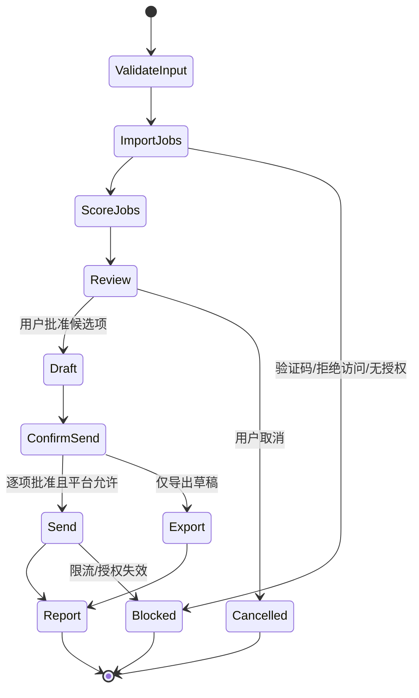

# 招聘职位筛选工作流案例

> 状态：Planned / Case Study
> 本文用于验证通用工作流能力，不是核心架构规范，也不表示已获得第三方平台自动化授权。

## 目标与边界

工作流帮助用户整理其有权访问的职位信息，依据显式条件评分，并在用户确认后生成沟通草稿。任何网页读取和外部发送都必须遵守平台条款、访问控制、隐私要求和适用法律。

明确禁止：

- 绕过验证码、登录限制、反自动化或速率控制；
- 伪造浏览器指纹、隐藏自动化特征或规避封禁；
- 未经用户逐项确认批量发送消息；
- 收集与求职判断无关的敏感个人信息。

遇到验证码、拒绝访问、异常限流或条款不允许自动化时，工作流应立即停止并报告，而不是尝试规避。

## 能力依赖

本案例只组合通用能力，不引入专属运行时：

- 授权的浏览器或数据导入 Tool；
- 通用结构化抽取与模型评分；
- Workflow 的 checkpoint、暂停和恢复；
- 受 [tool-permission.md](../security/tool-permission.md) 约束的审批与审计；
- 遵循 [skill-lifecycle.md](../skills/skill-lifecycle.md) 的 Skill 包装。

## 输入与输出

输入包含职位关键词、地区、薪资、经验、评分权重、最大候选数和数据来源。输出是可审阅的候选列表，每项包含来源、抽取事实、评分、理由和不确定性。

评分只能辅助排序，不能把模型推断伪装成招聘方事实。缺失字段应标记为未知，不得补造。

## 状态机

持久状态只保存工作流恢复所需的数据：`run_id`、输入摘要、候选引用、评分结果、审批记录和游标。登录凭证只能通过 CredentialStore 引用，不能写入 checkpoint。

## 审批规则

读取公开或用户导入的数据仍受 Workspace 范围限制。生成草稿不等于对外发送；每个外部收件人、消息正文和目标职位必须绑定一次可审计批准。批准发生后若正文、目标或身份发生变化，原批准失效。

系统级 hard-deny 和平台拒绝访问不能由 Auto 模式、Skill 配置或 Prompt 覆盖。

## 失败与恢复

- 可重试：短暂网络故障、模型超时；采用有上限的退避重试。
- 需人工处理：登录过期、字段歧义、发送内容变化。
- 不可继续：验证码、明确拒绝访问、平台禁止自动化、命中 hard-deny。
- 恢复时先重新验证权限和外部状态，不复用过期审批。

## 验收标准

- 在无外部发送的测试夹具上可完成导入、评分、审核和导出。
- 任何外部发送前均存在与目标及正文绑定的批准记录。
- 遇到验证码或拒绝访问时停止，且没有规避行为。
- 日志不包含登录凭证、完整简历或不必要的个人数据。
- 重启后能从 checkpoint 恢复，但会重新校验授权与审批有效性。
