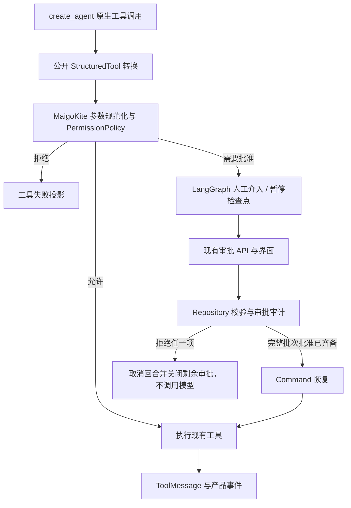

# 智能体运行时设计

> 权威范围：聊天执行、工具编排、审批桥接、上下文与运行资源的边界。
> 文档归并日期：2026-10-09。描述代码路径，不把新增代码或历史测试当作本次验收。

## 1. 执行入口与迁移范围

`AgentCore` 是组合根，不另建智能体框架。普通聊天目前存在两条临时路径：

| 路径 | 当前行为 | 边界 |
| --- | --- | --- |
| 默认 `legacy` | 自研模型循环、ExecutionEngine、TaskManager 与续接数据 | 保持回归，不再扩建执行框架 |
| 显式 `langgraph` | LangChain `create_agent` + LangGraph 检查点/HITL | 普通聊天与显式 `/tool` 均进入新路径；已适配文件、搜索、命令、联网、浏览器、技能与已连接 MCP，迁移未验收 |

配置与删除迁移开关的条件只在 [运行时迁移说明](../development/RuntimeMigration.md) 维护。目标是删除旧主循环，不是长期双运行时。

生产适配层只承担四类桥接代码：运行调用、界面事件映射、审批桥接、产品持久投影。模型协议、工具调度、检查点、暂停恢复和上下文摘要优先复用成熟组件，不在适配层内重建状态机、续接数据、事件总线或插件框架。

## 2. 状态与资源所有权

| 内容 | 所有者 / 查询来源 | 不承担的职责 |
| --- | --- | --- |
| 新路径执行状态与待审批调用 | LangGraph 检查点 | 不充当业务审计库 |
| 任务、消息、工具调用、审批与安全审计 | MaigoKite Repository | 不驱动第二套新运行时状态机 |
| `task_events / messages` | UI / 产品投影 | 不是运行时恢复的输入事实 |
| 根任务、模型提供方客户端、浏览器/MCP 资源 | 核心服务 / 运行时生命周期 | 单次运行实例不关闭其他运行实例的共享客户端 |

恢复执行看检查点，查询界面看产品投影，审批安全看 Repository。当前部分状态和事件仍分步提交；这是持久化一致性债务，不意味着需要完整事件溯源框架。

检查点仍按任务建立，避免改变既有审批恢复 ID。新回合优先从同会话最近创建、成功且已结束的任务 checkpoint 继承 LangGraph 保留的 messages（含摘要、工具调用和结果），不复制调用计数或待执行节点。同会话未完成任务阻止新回合启动；入口用原生 asyncio.Lock 防止并发提交。初次迁移、上一轮为 legacy 或失败/取消/中断时，只导入可见产品历史，不伪造工具结果或自动重放副作用。这是明确的上下文降级边界，不是任意失败点无损续接。内存 TaskManager 暂留给旧路径。

`/tool <name> <json-object>` 是产品命令语法，不再选另一套执行器：公开 `awrap_model_call` 将显式请求返回为原生 AIMessage 工具调用，随后仍经过同一 HITL、PermissionPolicy、ToolNode 与事件投影。工具结果通过同一模型节点返回给用户，不调用 LLM 决定或改写命令；这类命令也跳过摘要模型调用。`bash` 仅映射为 `exec_command` 兼容名，不扩大权限。当前仍需可初始化的模型配置以创建既有 agent 图。

原生模型由 `models/native_model.py` 创建，Core 持有缓存与客户端生命周期；ChatAdapter 和 Spike 兼容入口复用同一工厂，新路径不再通过 IChatProvider 创建模型。公开模型拦截能力见 [LangChain middleware](https://reference.langchain.com/python/langchain/agents/middleware/types/AgentMiddleware/wrap_model_call)。没有新增 Provider 协议、执行状态机或 continuation 数据。

## 3. 工具与审批



- ToolRegistry 负责发现、产品元数据和权限信息；新路径的调度由 LangChain/LangGraph 承担。通过公开转换入口接入，不依赖私有 `_structured` 字段。
- 原生工具结构定义由 Pydantic/LangChain 表达。产品参数检查复用 `jsonschema`，保留现有错误 DTO、参数清理和显式属性默认值处理；引用解析不得联网或读外部文件。
- 权限策略仍使用既有风险等级、规范化参数摘要值、审批版本、作用域、过期时间和审计。提示词、技能或模型声称“已获授权”没有效力。权威规则见 [工具权限](../agent-capabilities/security/tool-permission.md)。
- 新路径保留 HITL 原始完整调用批次，UI 一次只展示一项审批；全部批准收齐后才恢复工具执行。拒绝任一项结束该回合并关闭剩余待审批项，不再让模型确认拒绝、不恢复该 checkpoint 执行。已经批准的记录不是已经执行的证明。
- 新聊天与批准后的审批续接共用 Gateway 的凭证同步，Core 重启后先从既有密钥存储补齐内存凭证。新路径消费批准前检查模型可初始化，并等待前一个 interrupt 根任务退出；拒绝仍等待旧根任务退出，但不依赖密钥链、模型配置或 Provider。凭证不会写入 checkpoint 或审批记录。决定与恢复启动间仍存在崩溃窗口，不声称通用 exactly-once。
- 工具执行体使用每运行实例的 `asyncio.Lock` 串行化；这不提供跨运行实例的文件隔离，也不能终止同步线程。
- 已删除截断调用列表的 `_SerialApprovalMiddleware`。完整批次审批改动尚未验收；相同名称/参数、多项不重复调用、部分审批后重启和拒绝投影都需要回归。旧版本已丢失的调用不能补回。
- MCP 工具通过公开转换接入新运行时，`isError: true` 沿用 ToolResult.failure 并映射为错误 ToolMessage，保留原始结果与用户提示。stdio 已替换为官方 SDK 薄桥接，尚未验收生命周期或远端取消。协议与生命周期见 [MCP](../agent-capabilities/mcp/mcp-integration.md)。

工具选择与权限分离：默认十项基础工具，todo_write/sleep 显式启用，bash 仅兼容历史调用而不交给模型。
设置页控制已注册工具可见性，启动配置的停用列表是上限，执行前再检查选择与 PermissionPolicy。
公开转换复用 [LangChain ToolRuntime/StructuredTool](https://docs.langchain.com/oss/python/langchain/tools)，
仅桥接执行上下文和 ToolResult；jsonschema 校验不另建工具协议。ToolMessage 的产物字段（`artifact`）携带
产品结果，UI 事件保留 `error_code / user_hint / action`；凭证仅在执行上下文内传入。
文件查找与内容搜索复用 [ripgrep](https://github.com/BurntSushi/ripgrep)，删除原有 Python 遍历搜索。

工具名称稳定、目录顺序确定；描述说明用途和副作用，不含敏感凭证。MCP 命名空间防冲突。资源范围和风险必须由代码根据规范化参数判断，不能只依赖工具描述。

## 4. 用户可见事件

前端只接收 MaigoKite DTO，不接收 LangGraph 类型。事件字段、名称与重放约定唯一来源为 [API 设计](API.md)。

- `message.*` 承载用户可见回答；模型提供方单独返回的公开过程字段或可识别的过程文本进入活动区，不暴露隐藏思维链。
- 工具参数、结果与错误进入结构化 `tool.*`，默认不混入回答或输入框。
- 审批事件使用现有 `approval.*`，任务终态使用现有协议（成功当前为 `task.succeeded`），不为新运行时重命名。
- 摘要模型输出不投影到用户消息；ToolResult、网页和技能正文是不可信上下文，不能改变权限。
- WebSocket 断线不取消任务。聊天和审批流均透传持久化 event_id/sequence；前端补拉连续分页，并缓冲快照加载期间的事件后再应用。服务端仍没有原子快照/订阅游标协议，不能仅凭代码接线宣称完整断线恢复已验收。

## 5. 取消与客户端生命周期

新路径只持有根 `asyncio.Task`：

```text
取消请求
→ root_task.cancel()
→ 等待模型 / 工具 / 执行图事件流结束并清理资源
→ 确认运行实例结束
→ 持久化并发布 task.cancelled
```

核心服务关闭先取消并等待全部运行实例，再关闭 MCP、浏览器、模型提供方客户端和 Repository。单个运行实例取消不关闭共享 HTTP 客户端；模型提供方客户端按工作区/配置项由核心服务持有，轮换后旧实例保留至安全关闭，执行图缓存键随模型实例更新。

本地 Ollama/OpenAI-compatible 不借用云端环境密钥，并保持本地端点绕过系统代理的行为。连接验证产生的临时客户端必须关闭。

限制：同步线程工具无法立即停止；第三方 MCP 传输方式和旧主循环的取消仍有边界。不得在任务实际仍执行时先宣称停止，不为此建立自研线程杀死机制或取消树。

## 6. 提示词、上下文与缓存

### 当前输入

固定指令与按名称排序的本地技能目录，结合持久聊天历史、完整工具回合和实际工具结构定义。技能正文通过 `skill read` 按需加载，不每轮重建系统提示词。

目前没有自动注入用户记忆、知识库或向量嵌入检索。`python/agent/prompts/` 的遗留模板/解析器未接入当前聊天协议。长期记忆归 [记忆](../agent-capabilities/memory/memory-system.md)，不是上下文压缩的别名。

### 输入预算与摘要

- `context.max_tokens` 默认 32000，表示人工配置的输入预算，不是自动探测模型容量。计数为近似值；须预留输出、摘要提示和估算误差。
- legacy 复用 LangChain `trim_messages` 生成输入投影，计入结构定义开销，保留系统指令、最近用户请求及完整工具回合。不改写数据库原文；不能安全保留当前回合时明确报错。
- 新路径复用 `SummarizationMiddleware`，从预算扣除固定指令/结构定义，约剩余预算 80% 触发，保留约 40% 近期内容；工具配对可能增加保留量。
- 薄保护保留系统指令与最近用户请求。摘要失败、为空或没有缩减时不提交替换；取消随根任务传播并等待结束。
- 摘要是有损信息。超大输入或工具结果、初始历史已超模型提供方容量时可能仍失败，不构建无限重试或第二套分块摘要引擎。

### 缓存和调用限制

- 工具目录与系统指令前缀保持稳定；未触发压缩时不改写历史，不放入任务 ID、时钟或实时状态。
- Anthropic 使用官方 `AnthropicPromptCachingMiddleware`，当前默认 TTL 5 分钟；其他模型提供方不接收 Anthropic 参数。
- 保存模型提供方实际返回的 `model.usage`，可包含缓存读取/创建、推理词元。缺失不是零命中；当前主模型记录不等于包含摘要成本的完整账单。
- 不按模型名称硬编码缓存率、价格或容量；服务端缓存不等于本地回答缓存。
- 原生 `ModelCallLimitMiddleware` 按任务检查点计主模型调用，审批恢复不清零；摘要调用不计入该上限。
- legacy 降级仅允许在任何数据片段输出之前发生；已输出文本或工具调用参数后失败就结束请求，禁止拼接两个模型的流。产品自动路由/降级设置仍未接线。

复用依据：[LangChain 中间件](https://docs.langchain.com/oss/python/langchain/middleware/built-in)、[OpenAI 提示词缓存](https://developers.openai.com/api/docs/guides/prompt-caching)、[Anthropic 提示词缓存](https://platform.claude.com/docs/en/build-with-claude/prompt-caching)。这些链接是既有设计依据，本次文档归并没有重新验证服务端表现。

## 7. 技能、子任务与工作流边界

当前 `instruction / workflow` 技能只提供可读取的声明流程，不执行包内代码、不扩大权限，也不是可恢复 DAG。编写格式和加载规则仅在 [技能](../agent-capabilities/skills/skill-lifecycle.md) 维护。

后续先选择一个真实个人流程：输入、交付物、审批位置、失败处理可验证后再实现。能用顺序技能完成的，不升级为工作流引擎。

确有独立、耗上下文且有并行收益的子任务时，先复用 [LangGraph 子图](https://docs.langchain.com/oss/python/langgraph/use-subgraphs) / [LangChain subagent 模式](https://docs.langchain.com/oss/python/langchain/multi-agent/subagents)，不另建自研 SubAgentManager。候选首版为显式委派、只读、单层、有限并发，独立执行状态，父任务只收摘要和产物引用；取消必须等待子任务退出。

持久确定性流程先评估现有检查点的组合，不另建工作流平台。缓存预热、复杂插件生命周期、版本化提示词/对照评测与自动重规划均非当前交付；只有实测需求和收益后才考虑。

### 空骨架清理不取消能力需求

2026-10-10 移除 `workflow/engine.py`、`workflow/hitl.py`、`workflow/__init__.py`、`sub_agent_manager.py`、`recovery.py` 五个文件。依据不只是“没有调用”：初始化和执行方法均为 `...`，没有生产或测试消费者，也没有需要保持的已用接口契约；其中预设的编排/HITL/恢复职责应优先由现有 Runtime 承担。源码可从 Git 历史恢复，不删除业务数据或真实执行入口。

| 保留的能力 | 已有实现 / 事实 | 真实缺口与后续归属 |
| --- | --- | --- |
| 人工审批 / HITL | PermissionPolicy、Approval API/Repository、LangGraph HumanInTheLoopMiddleware | 保留风险/参数 hash/version/审计；补齐新路径多审批和重启语义，不恢复第二套 HITLCoordinator |
| 状态恢复 / Recovery | LangGraph checkpoint、resume_approval/recover、Core 中断任务对账 | 恢复与投影一致性、副作用重放和浏览器/MCP 易失状态仍有缺口；复用检查点并按工具明确可恢复边界，不增加通用 rollback/retry 状态机 |
| 个人工作流 | Skill 可读取声明步骤，当前不是持久执行图 | 保留流程复用目标；需要确定性分支/暂停/恢复时组合 LangGraph 图与现有审批，不把空 WorkflowEngine 计作实现 |
| 子 Agent | 当前没有生产委派/汇总入口 | 保留隔离上下文与受控委派目标；采用子图/成熟 subagent 组合，MaigoKite 负责权限、预算和产品事件 |

第一批不删除 legacy 主循环、TaskManager、ExecutionEngine、Provider 或 continuation 字段。后续删除条件与 KEEP/ADAPT/DELETE 清单仅在迁移说明维护；完成空壳清理不提升上述能力的完成度。

## 8. 文件副作用与验证状态

LangGraph 恢复是至少执行一次（at-least-once），不保证工具恰好一次（exactly-once）。当前 `file_write` 在授权后比较目标文件内容；内容与预期一致时返回已核对结果，不重复写入。它只覆盖相同内容的自然状态核对，不涵盖不同内容、外部修改、并发运行实例或任意工具副作用。

审批后尚未执行、写入已发生但 ToolMessage/检查点未提交两类崩溃点均须保留真实测试，不能用投影成功掩盖重放行为。

验证入口见 [测试与验收](../testing/TestPlan.md)。现有重点文件：

| 入口 | 验证对象 |
| --- | --- |
| `test_langgraph_production.py` | 生产桥接、审批、取消、投影与文件结果 |
| `test_langgraph_process_recovery.py` | 真实进程终止/重启、检查点和副作用恢复 |
| `test_context_optimization.py` | 输入预算、配对、摘要失败/取消、技能、用量及凭证轮换 |
| `test_runtime_spike_http.py` | 本地 HTTP/SSE 模型提供方协议；不代替真实服务验收 |

此前上下文优化记录为 Python 100 项通过、4 项跳过，相关 Ruff/mypy 通过；这是历史版本结果，不覆盖后续 HITL、JSON Schema、MCP 错误或流式降级修改。最近这些修改没有运行测试、静态检查、构建或真实模型提供方验收，默认路径仍为 legacy。测试文件存在不表示验收通过。

## 9. 既有研究依据与采用边界

以下保留此前研究快照，不作为本次文档归并的新调研或验收。

主要参考仍为 Codex、Claude Code、DeepSeek Harness；按用户要求将 **pi** 纳入固定参考范围，重点对照轻量个人智能体的实现。纳入参考不等于引入依赖或重新选择运行时。

| 项目 | 工作流与子智能体 | 上下文与缓存 | 对 MaigoKite 的取舍 |
| --- | --- | --- | --- |
| DeepSeek Harness | 工作流通过 JS 脚本组合子智能体，提供顺序流水线、并行组合；当前实现不支持工作流进程重启续跑。子任务结果追加到父上下文，中间过程不整段回灌 | 压缩保持工具调用与结果配对；压力下可先裁剪工具结果，再摘要。稳定的请求前缀有利于服务端缓存 | 学习边界和故障语义，不移植 Cordis、JS VM 或能力插件体系 |
| Codex | 技能承载可复用流程；子智能体隔离探索、测试等中间内容，父任务收集摘要 | 工具列表顺序、稳定指令和历史前缀影响缓存；公开架构说明中使用 Responses 上下文压缩管理长上下文 | 学习稳定前缀与按需加载，不将 OpenAI 专有压缩接口强加给 Ollama/兼容服务 |
| Claude Code | 技能与隔离子智能体分工；动态工作流支持脚本编排、保存与按已有结果重放，不等于副作用恰好一次（exactly-once） | 清理旧工具输出再压缩。官方工作流文档说明，同前缀子智能体可错峰启动以复用缓存 | 借鉴按任务隔离、结果汇总及缓存观测；当前没有子任务并行派发，不加入预热队列 |
| pi | 对照智能体核心的工具调用调度、事件、取消及运行中补充指令/后续消息；区分核心能力、扩展与示例，不把后两者当作内置工作流或子智能体 | 对照上下文压缩、分支摘要、模型输入投影及模型提供方缓存行为 | 研究小核心与按需扩展的边界；优先评估成熟组件，不将 TypeScript 主循环翻译成另一套 Python 运行时 |

DSH 源码快照：`d743267388641bc76f17c45ce8b4c231aed1d32c`。
依据：[工作流](https://github.com/deepseek-ai/deepseek-harness/blob/d743267388641bc76f17c45ce8b4c231aed1d32c/packages/workflow/workflow/README.md)、[子智能体](https://github.com/deepseek-ai/deepseek-harness/blob/d743267388641bc76f17c45ce8b4c231aed1d32c/packages/subagent/subagent/README.md)、[上下文压缩](https://github.com/deepseek-ai/deepseek-harness/blob/d743267388641bc76f17c45ce8b4c231aed1d32c/docs/subsystems/compaction.md)、[DeepSeek 适配层](https://github.com/deepseek-ai/deepseek-harness/blob/d743267388641bc76f17c45ce8b4c231aed1d32c/packages/llm/llm-deepseek/README.md)。

Codex 依据：[智能体主循环官方说明](https://openai.com/index/unrolling-the-codex-agent-loop/)、[技能](https://learn.chatgpt.com/docs/build-skills)、[子智能体](https://learn.chatgpt.com/docs/agent-configuration/subagents)。Claude Code 依据：[运行机制](https://code.claude.com/docs/en/how-claude-code-works)、[技能](https://code.claude.com/docs/en/skills)、[子智能体](https://code.claude.com/docs/en/sub-agents)、[工作流](https://code.claude.com/docs/en/workflows)。Claude Code 结论仅依据公开文档，不声称核验其未公开内部实现。

### pi 的参考范围

2026-10-09 访问原仓库 `badlogic/pi-mono` 时，其地址重定向至 [earendil-works/pi](https://github.com/earendil-works/pi)。本次仅补充参考范围并初读官方文档与主循环入口，不代表完成整个仓库的源码审阅；后续形成具体实现结论时需固定提交版本，避免混用不同版本行为。

- **pi-agent-core**：重点调查工具调用与结果配对、顺序/并发执行、事件顺序、取消完成边界，以及用户运行中补充指令和后续消息的区别。依据：[智能体核心](https://github.com/earendil-works/pi/blob/main/packages/agent/README.md)、[主循环源码](https://github.com/earendil-works/pi/blob/main/packages/agent/src/agent-loop.ts)。
- **pi-ai**：重点调查多模型提供方、OpenAI-compatible 兼容边界、流式工具调用、异常/取消与用量反馈；比较可复用组件和当前模型适配器的维护成本，不自行抄写协议实现。依据：[pi-ai](https://github.com/earendil-works/pi/blob/main/packages/ai/README.md)。
- **pi-coding-agent**：重点调查会话上下文投影、压缩与分支摘要、技能按需加载及扩展边界；只借鉴通用个人智能体能力，不把产品重新收窄为编码助手。依据：[编码智能体](https://github.com/earendil-works/pi/tree/main/packages/coding-agent)、[上下文压缩](https://github.com/earendil-works/pi/blob/main/packages/coding-agent/docs/compaction.md)。
- **采用门槛**：当前核心服务为 Python，pi SDK 为 TypeScript。需比较直接复用/进程适配所带来的部署和生命周期成本与可删除的自研代码，不因它轻量就直接加入第二个执行内核；若替换收益明确，再单独提出迁移决策。本次不修改运行代码、不安装 pi、不运行测试。
