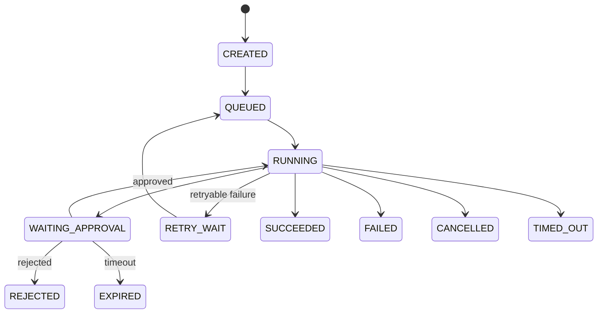

# NanamiGopher 后端设计

> **状态**：Current
> **架构版本**：v1
> **最后核验**：2026-09-14
> **权威范围**：Go Gateway 与 Python Agent Core 的内部边界

总体职责、部署形态和信任边界见 [SystemDesign](SystemDesign.md)。REST/gRPC/事件字段见 [API](API.md)，数据字段见 [Database](Database.md)。

## 1. 后端边界

```text
External Client
    → Go Gateway
        → authenticated command over gRPC
            → Python Agent Core
                → Model / Tool / Memory / Storage
```

Go 负责边缘控制，Python 负责 Agent 领域。两者不得共同管理 ToolRegistry、MCP 进程或 Agent 运行状态。

## 2. Go API Gateway

### 2.1 职责

- HTTP 与 WebSocket 连接管理。
- 认证、请求大小限制、速率限制和输入格式校验。
- 解析用户与 Workspace 上下文，执行 AccessPolicy。
- 将外部请求转换为 gRPC 命令。
- 将 Python 事件转发给有权限的 WebSocket 订阅者。
- 对外隐藏 Python、MCP 与存储的内部地址。

### 2.2 非职责

- 不启动 Python Agent Core。
- 不启动或调用 MCP Server。
- 不执行 Native Tool。
- 不作最终 ToolPolicy 判断。
- 不直接写会话、任务、审批、记忆或 ToolCall 状态。

### 2.3 模块建议

```text
gateway/
├── cmd/gateway/           # 进程入口
├── internal/api/          # REST handlers
├── internal/websocket/    # 事件连接与订阅
├── internal/grpc/         # Python client
├── internal/auth/         # 身份验证
├── internal/access/       # Workspace AccessPolicy
├── internal/credential/   # 凭证引用与代理边界
├── internal/observability/
└── internal/config/
```

Handler 只完成协议转换：验证外部输入、构建可信调用上下文、调用 Python、映射响应。业务状态转换不能写在 Handler 中。

## 3. Python Agent Core

### 3.1 职责

- gRPC 服务端和 Agent 命令入口。
- Session、Task、Approval 和 ToolCall 状态机。
- ExecutionEngine、Context Builder 和 Model Router。
- ToolPolicy、ToolRegistry、Native Tool 和 MCPClient。
- Working/Conversation/User Memory 与 Knowledge Base。
- 领域状态写入、事件生产和恢复。

### 3.2 模块建议

```text
python/
├── agent/
│   ├── runtime/            # task、execution、context、recovery
│   ├── tools/              # registry、policy、native、mcp adapter
│   ├── mcp/                # MCP lifecycle and protocol
│   ├── memory/
│   ├── knowledge_base/
│   ├── models/
│   ├── skills/
│   ├── workflow/
│   ├── persistence/        # repository and unit of work
│   ├── events/
│   └── observability/
├── proto/
└── tests/
```

## 4. 命令处理

每个 gRPC 命令必须携带由 Gateway 注入的调用上下文：

```text
request_id
trace_id
principal_id
workspace_id
session_id（按命令可选）
deadline
```

处理顺序：

```text
验证调用上下文
→ 检查 Workspace 资源归属
→ 建立 Unit of Work
→ 执行业务命令
→ 同事务写入状态与 OutboxEvent
→ 提交
→ 异步发布事件
```

外部客户端不能自行声明可信的 `principal_id` 或 `workspace_id`。

## 5. 任务状态机



- 状态转换由 TaskManager 统一执行。
- Tool 不直接修改任务状态。
- 副作用调用保存 idempotency key。
- 恢复器只重试明确标记为可重试且满足幂等要求的操作。

## 6. 工具执行

```text
ExecutionEngine
→ ToolRegistry.resolve(name)
→ 参数 Schema 校验与规范化
→ ToolPolicy.evaluate(context, capability, arguments, scope)
→ allow / approval_required / deny
→ SandboxPolicy
→ NativeTool.execute 或 MCPClient.call_tool
→ 保存 ToolCall 与审计事件
```

ToolPolicy 的权威规则见 [tool-permission](../agent-capabilities/security/tool-permission.md)。

## 7. 审批一致性

- 审批由 Python 创建并持久化，Go 只负责 API 与事件展示。
- 决策必须绑定 principal、task、tool call、规范化参数摘要、资源范围和过期时间。
- 用户修改参数后旧审批失效。
- 审批和任务状态在同一事务中更新。

## 8. MCP 生命周期

Python MCP Manager 负责：

```text
验证 SkillGrant
→ 构建最小环境
→ 启动子进程
→ initialize
→ tools/list
→ 注册 MCPTool
→ 健康监测
→ 停止/重启
```

Go 不维护第二个 MCP Manager。完整规范见 [MCP Integration](../agent-capabilities/mcp/mcp-integration.md)。

## 9. 数据和事务

- Repository 对业务层隐藏 SQLite/PostgreSQL 差异。
- 一个命令使用一个 Unit of Work。
- 状态与对应 OutboxEvent 同事务提交。
- Vector/FTS 更新异步完成，可从权威数据重建。
- Secret 只通过 CredentialProvider 获取，不进入 Memory 或普通日志。

## 10. 错误与恢复

错误统一分为：Validation、Authentication、AccessDenied、ApprovalRequired、ToolDenied、NotFound、Conflict、RateLimited、DependencyUnavailable、Timeout 和 Internal。

- Gateway 映射外部状态码，不改写领域含义。
- Python 返回稳定错误码和是否可重试标志。
- 日志保留 trace/request/task ID，不记录原始 Secret。
- deadline 和 cancellation 从 Gateway 传播到 Tool 与 MCP。

## 11. 可观测性

- Gateway 创建或接收 trace ID。
- Python 为模型、检索、Tool 和 MCP 调用创建 span。
- 业务事件、日志和指标使用一致的 task/tool call ID。
- WebSocket 断开不取消任务；取消必须使用显式命令。

## 12. Phase 1 模型设置闭环

```text
Vue Settings
→ Gateway model profile API
→ 非敏感模型配置集合和默认模型经 gRPC 写入 Python Workspace Settings
→ Secret 按模型配置 ID 写入 Gateway 的 OS CredentialStore，并只同步到 Python 进程内存
→ ChatModelRuntime 按 Workspace + model profile 创建或失效 Provider 缓存
→ 会话保存 model_id 与 response_mode，下一条消息使用该配置
```

- 模型凭证按配置 ID 隔离；Provider 或 Base URL 变化时旧凭证失效，禁止跨端点复用 Secret。
- Ollama 和 OpenAI-compatible 本地端点不读取云端环境密钥，并绕过系统 HTTP 代理。
- Phase 1 支持多配置、默认模型和会话级选择；自动路由、fallback 与模型发现留到 Phase 2。
