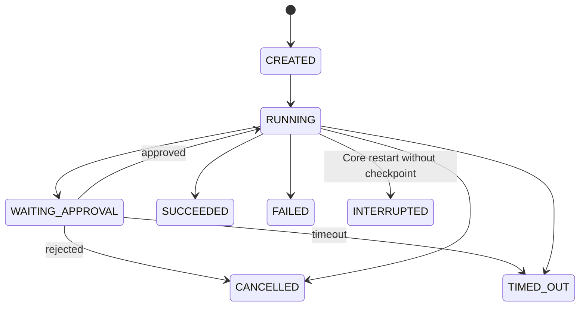

# NanamiGopher 后端设计

> **状态**：Current
> **架构版本**：v1
> **最后核验**：2026-09-18
> **权威范围**：Go Gateway 与 Python Agent Core 的内部边界

总体职责、部署形态和信任边界见 [SystemDesign](SystemDesign.md)。REST/gRPC/事件字段见 [API](API.md)，数据字段见 [Database](Database.md)。

## 1. 后端边界

```text
External Client
    → Go Gateway
        → authenticated command over gRPC
            → Python Agent Core
                → Model / Tool / Memory / Storage
```

Go 负责边缘控制，Python 负责 Agent 领域。两者不得共同管理 ToolRegistry、MCP 进程或 Agent 运行状态。

## 2. Go API Gateway

### 2.1 职责

- HTTP 与 WebSocket 连接管理。
- 认证、请求大小限制、速率限制和输入格式校验。
- 解析用户与 Workspace 上下文，执行 AccessPolicy。
- 将外部请求转换为 gRPC 命令。
- 将 Python 事件转发给有权限的 WebSocket 订阅者。
- 对外隐藏 Python、MCP 与存储的内部地址。

### 2.2 非职责

- 不启动 Python Agent Core。
- 不启动或调用 MCP Server。
- 不执行 Native Tool。
- 不作最终 ToolPolicy 判断。
- 不直接写会话、任务、审批、记忆或 ToolCall 状态。

### 2.3 当前模块

```text
gateway/
├── cmd/gateway/           # 进程入口
├── internal/api/          # REST handlers
├── internal/websocket/    # 事件连接与订阅
├── internal/grpc/         # Python client
├── internal/credentialstore/ # OS 凭证边界
├── internal/observability/
└── internal/config/
```

Handler 只完成协议转换：验证外部输入、构建可信调用上下文、调用 Python、映射响应。业务状态转换不能写在 Handler 中。

## 3. Python Agent Core

### 3.1 职责

- gRPC 服务端和 Agent 命令入口。
- Session、Task、Approval 和 ToolCall 状态机。
- ExecutionEngine、Context Builder 和 Model Router。
- ToolPolicy、ToolRegistry、Native Tool 和 MCPClient。
- Conversation Context；User Memory 已有显式 CRUD，但自动注入与 Knowledge Base 属于后续阶段。
- BrowserRuntime、本地 SkillRegistry 和持久 TaskEvent Journal。
- 领域状态写入、事件生产和恢复。

### 3.2 目标模块收敛（Planned）

```text
python/
├── agent/
│   ├── runtime/            # task、execution、context、recovery
│   ├── tools/              # registry、policy、native、mcp adapter
│   ├── mcp/                # MCP lifecycle and protocol
│   ├── memory/
│   ├── knowledge_base/
│   ├── models/
│   ├── skills/
│   ├── workflow/
│   ├── persistence/        # repository and unit of work
│   ├── events/
│   └── observability/
├── proto/
└── tests/
```

## 4. 命令处理

目标是让每个 gRPC 命令携带由 Gateway 注入的统一调用上下文：

```text
request_id
trace_id
principal_id
workspace_id
session_id（按命令可选）
deadline
```

当前 Proto 在各请求上直接携带 `workspace_id`，消息与审批请求另带 `principal_id`；`request_id / trace_id / deadline` 尚未统一为 `CallContext`。目标处理顺序是：

```text
验证调用上下文
→ 检查 Workspace 资源归属
→ 建立 Unit of Work
→ 执行业务命令
→ 同事务写入状态与 OutboxEvent
→ 提交
→ 异步发布事件
```

外部客户端不能自行声明可信的 `principal_id`。`workspace_id` 虽位于 URL/Proto，仍必须通过 Workspace access 检查。

## 5. 任务状态机



- 当前内存 TaskManager 与 SQLite Repository 各自维护投影，尚未收敛为单一持久状态机；Repository 是对外恢复的事实来源。
- Tool 不直接修改任务状态。
- `queued / retry_wait / rejected / expired` 已保留为目标状态，但当前没有调度器驱动这些路径。
- 副作用 ToolCall 保存参数和 continuation，但通用 idempotency key 尚未实现。
- 当前不自动重试副作用；未来恢复器只能重试明确满足幂等要求的操作。
- 当前只有不依赖易失运行时资源的 Approval continuation 可恢复；Browser session 相关审批和其他无检查点非终态任务在关闭/启动协调时标记 interrupted。

## 6. 工具执行

```text
ExecutionEngine
→ ToolRegistry.resolve(name)
→ 参数 Schema 校验与规范化
→ ToolPolicy.evaluate(context, capability, arguments, scope)
→ allow / approval_required / deny
→ SandboxPolicy
→ NativeTool.execute 或 MCPClient.call_tool
→ 保存 ToolCall 与审计事件
```

ToolPolicy 的权威规则见 [tool-permission](../agent-capabilities/security/tool-permission.md)。

## 7. 审批一致性

- 审批由 Python 创建并持久化，Go 只负责 API 与事件展示。
- 决策必须绑定 principal、task、tool call、规范化参数摘要、资源范围和过期时间。
- 用户修改参数后旧审批失效。
- 审批和任务状态在同一事务中更新。

## 8. MCP 生命周期

Python MCP Manager 负责：

```text
读取部署配置
→ 构建环境变量 allowlist
→ 启动 stdio 子进程
→ initialize
→ tools/list
→ 注册 MCPTool
→ Core shutdown 时停止
```

健康重启、空闲回收和 SkillGrant 属于 Planned。当前本地 Skill 不启动进程，只扫描受限目录中的声明式 `SKILL.md`，通过 `skill` Tool 按需读取。

Go 不维护第二个 MCP Manager。完整规范见 [MCP Integration](../agent-capabilities/mcp/mcp-integration.md)。

## 9. 数据和事务

- 当前只有 SQLiteRepository；它隐藏 SQL 细节，但不承诺 PostgreSQL 兼容。
- 当前没有正式 Unit of Work 或 Outbox。Task/ToolCall 状态与 `task_events` 的部分写入仍为分步事务，这是发布前架构债务。
- Vector/FTS 尚未接入；未来只能作为可从权威数据重建的派生索引。
- Secret 只通过 CredentialProvider 获取，不进入 Memory 或普通日志。

## 10. 错误与恢复

错误统一分为：Validation、Authentication、AccessDenied、ApprovalRequired、ToolDenied、NotFound、Conflict、RateLimited、DependencyUnavailable、Timeout 和 Internal。

- Gateway 映射外部状态码，不改写领域含义。
- Python 返回稳定错误码和是否可重试标志。
- 日志保留 trace/request/task ID，不记录原始 Secret。
- HTTP 断线不取消任务；显式取消在模型流和 Tool 边界检查。MCP 请求有超时，但正在执行的第三方调用暂不能被可靠抢占。

## 11. 可观测性

- 当前 Gateway/Python 使用控制台观测和 task/tool call ID；统一 request/trace 传播与 span 属于 Planned。
- 业务事件、日志和指标使用一致的 task/tool call ID。
- WebSocket 断开不取消任务；取消必须使用显式命令。

## 12. Phase 1 模型设置闭环

```text
Vue Settings
→ Gateway model profile API
→ 非敏感模型配置集合和默认模型经 gRPC 写入 Python Workspace Settings
→ Secret 按模型配置 ID 写入 Gateway 的 OS CredentialStore，并只同步到 Python 进程内存
→ ChatModelRuntime 按 Workspace + model profile 创建或失效 Provider 缓存
→ 会话保存 model_id 与 response_mode，下一条消息使用该配置
```

- 模型凭证按配置 ID 隔离；Provider 或 Base URL 变化时旧凭证失效，禁止跨端点复用 Secret。
- Ollama 和 OpenAI-compatible 本地端点不读取云端环境密钥，并绕过系统 HTTP 代理。
- Phase 1 支持多配置、默认模型、会话级选择、连接验证和服务端模型目录发现；按能力/成本自动路由与 fallback 留到 Phase 2。
