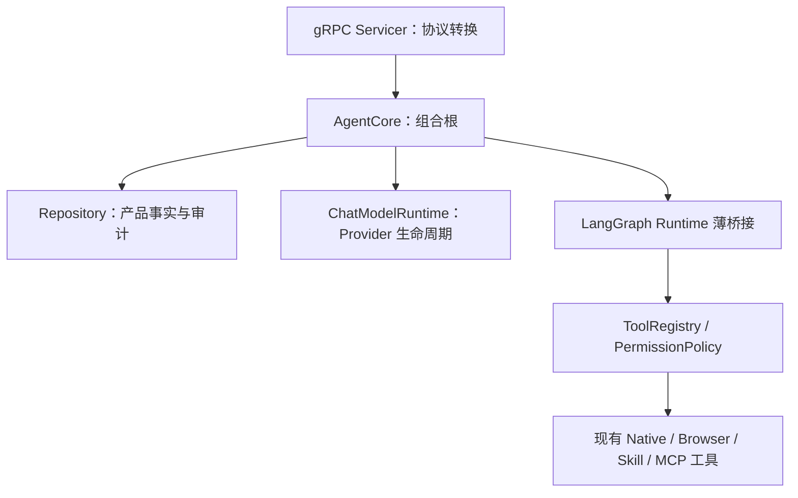

# 后端设计

> 权威范围：Go 网关、Python 智能体核心的内部职责与依赖。
> 执行机制见 [智能体运行时设计](AgentRuntime.md)，对外契约见 [API 设计](API.md)，存储见 [数据库设计](Database.md)。

## 1. 服务边界

```text
Vue / 外部 Client
→ Go Gateway：认证、资源归属、HTTP/WebSocket、凭证边界
→ Python Core：Agent 产品命令、策略、工具与持久化
→ 选定 Runtime / Provider / 工具进程
```

Go 不运行智能体主循环、内置工具或 MCP Manager，不直接写任务、审批与消息。Python 不面向公网暴露独立业务 API。当前本地核心服务启动由桌面/开发进程管理负责，不由网关 handler 启动。

## 2. Go 网关

- Handler 验证协议输入，解析可信 principal 与工作区，调用 AccessPolicy，再转换 gRPC 命令和响应。
- WebSocket 转发有权限订阅者的持久事件，沿用 Python 的 event ID/sequence，不生成第二套事件身份。
- 凭证存储保存模型配置对应的敏感凭证，普通配置与响应不回显。凭证只按受控路径同步到核心服务内存。
- 工作区文件树、预览和 Git 差异是只读产品查询；先解析根目录与资源归属，再访问文件或执行受限 Git 命令。
- 认证、请求限流与协议错误映射由网关承担，不在 handler 内复制审批策略和运行时状态机。

模块入口为 `gateway/cmd/gateway`，协议层在 `internal/api / websocket / grpc`，凭证在 `internal/credentialstore`。目录清单以仓库为准，开发操作见 [开发指南](../development/DevelopmentGuide.md)。

## 3. Python 组合根



- `AgentServiceServicer` 转换 Proto 与事件流，领域写入委托核心服务。
- `AgentCore` 组织聊天入口、设置、审批、取消与关闭，不继续生长为通用执行框架。
- 执行/检查点/HITL 统一属于 LangChain/LangGraph；旧路径和 feature flag 已移除。资源所有权和历史任务边界见 AgentRuntime。
- ToolRegistry 只保留发现、结构定义/产品元数据、权限与公开转换入口；不为新路径自建工具调度。
- 浏览器复用 Playwright；本地技能是受限声明内容；MCP 进程/协议只由 Python 管理。不得在 Go 或渲染进程再建一套执行与权限体系。

## 4. 命令与状态边界

外部客户端不能自行声明可信 principal。当前 Proto 各请求直接携带工作区，消息与审批等请求携带 principal；统一 request/trace/deadline CallContext 尚未完整接线，不将目标结构写成当前协议。

命令应先完成身份/资源归属与参数校验，再进入产品逻辑。任务、工具调用、审批及事件持久化的实际结构定义和事务限制以 Database 为准。

- 当前仅 SQLiteRepository；没有 PostgreSQL 兼容承诺。
- 新运行时恢复看检查点，审批校验看 Repository，UI 看 messages/task_events。
- 内存 TaskManager 已删除；运行续接只看 LangGraph checkpoint，Repository 保留业务投影与审批审计，不建第二套状态机。
- 部分状态与事件独立事务写入，尚无正式 Unit of Work/Outbox。修复应按一致性需求决定，不预设必须引入大型持久化框架。
- 索引若未来加入，须可从权威数据重建；敏感凭证不进入消息、记忆或日志。

## 5. 工具与依赖

权限矩阵、审批摘要值/版本/过期规则仅由 [工具权限](../agent-capabilities/security/tool-permission.md) 定义；模型文字不授权，参数变更使旧审批失效。

MCP discovery、stdio 子进程与关闭边界仅由 [MCP 集成](../agent-capabilities/mcp/mcp-integration.md) 定义。当前不实现第二个 MCP 生命周期层，全面官方 SDK 迁移另行验收。

HTTP 断线不取消任务；取消必须显式提交。新运行时根任务清理完成后才发布 cancelled；旧路径和第三方阻塞调用的限制见 AgentRuntime。恢复依赖浏览器易失 session 的审批不能视为安全续跑。

错误码与 HTTP/gRPC 映射唯一来源为 API。日志与诊断见 [日志与诊断](../ops-security/Observability.md)，内部错误不得向用户回显敏感凭证、堆栈或内部部署地址。

## 6. 模型配置闭环

```text
Settings → Gateway
→ 非敏感 profile/default 经 gRPC 保存到 Workspace Settings
→ Secret 按 profile ID 保存到 OS CredentialStore
→ Core 内存获取受控凭证
→ ChatModelRuntime 按 Workspace/profile 创建或更新 Provider
→ Conversation 保存模型选择，下一条消息使用
```

模型提供方/基础地址变化时旧凭证不能跨端点复用；本地 Ollama/OpenAI-compatible 不读取云端环境密钥。共享客户端由核心服务持有，正常关闭前等待活动运行实例。

当前支持多配置、默认模型、会话选择、连接验证与服务端模型目录发现；不等于已实现模型配置目录的自动能力/成本路由。产品字段与发现兼容策略见 [模型接入与选择](../agent-capabilities/models/model-routing.md)。
