# NanamiGopher Python Agent Core 类图

> 本文档描述了 NanamiGopher 系统中 Python Agent Core (:8081) 的核心类结构、接口定义以及类之间的关系。

---

## 类图

```mermaid
classDiagram
    %% ========================
    %% 接口定义
    %% ========================
    
    class IConfigManager {
        <<interface>>
        +get_model_config(provider) ModelConfig
        +get_memory_config() MemoryConfig
        +get_storage_config() StorageConfig
        +get_security_config() SecurityConfig
        +reload()
    }

    class IMemorySystem {
        <<interface>>
        +store(message) void
        +retrieve(conversation_id, query) MemoryResult
        +summarize(conversation_id) Summary
        +clear(conversation_id) void
    }

    class IKnowledgeBase {
        <<interface>>
        +add_document(doc) void
        +search(query, top_k) SearchResult[]
        +embed(text) float[]
        +delete(document_id) void
    }

    class ITaskManager {
        <<interface>>
        +create_task(config) Task
        +execute(task_id) void
        +cancel(task_id) void
        +get_status(task_id) TaskStatus
        +list_tasks(user_id) Task[]
    }

    class ISkillRegistry {
        <<interface>>
        +register(skill) void
        +unregister(skill_name) void
        +get_skill(name) Skill
        +list_skills() Skill[]
        +resolve_tool(tool_name) BaseTool
    }

    class IEventBus {
        <<interface>>
        +publish(event_type, payload) void
        +subscribe(event_type, handler) Subscription
        +unsubscribe(subscription) void
        +emit(event_type, payload) void
    }

    class IExecutionRecovery {
        <<interface>>
        +handle_failure(error, context) RecoveryAction
        +retry(task_id, max_attempts) bool
        +rollback(task_id) bool
        +fallback(tool_name) BaseTool
        +skip(task_id, reason) void
    }

    class IObservability {
        <<interface>>
        +trace_request(span) SpanContext
        +record_metric(name, value, labels) void
        +log_event(level, message, context) void
        +export_metrics() MetricsSnapshot
    }

    class IStorage {
        <<interface>>
        +save(key, value) void
        +load(key) value
        +delete(key) void
        +query(sql, params) ResultSet
        +fts_search(table, query) ResultSet
    }

    %% ========================
    %% 实现类
    %% ========================

    class ConfigManager {
        -config_dict dict
        -watcher FileWatcher
        +get_model_config(provider) ModelConfig
        +get_memory_config() MemoryConfig
        +get_storage_config() StorageConfig
        +get_security_config() SecurityConfig
        +reload()
    }

    class MemorySystem {
        -short_term ShortTermMemory
        -conversation ConversationMemory
        -user UserMemory
        -knowledge_base KnowledgeBase
        +store(message) void
        +retrieve(conversation_id, query) MemoryResult
        +summarize(conversation_id) Summary
        +clear(conversation_id) void
    }

    class ShortTermMemory {
        -max_messages int
        -storage IStorage
        +get_recent(conversation_id, limit) Message[]
        +add(message) void
        +truncate(conversation_id, keep_n) void
    }

    class ConversationMemory {
        -storage IStorage
        +get_conversation(conversation_id) Message[]
        +get_summary(conversation_id) string
        +build_summary(messages) string
    }

    class UserMemory {
        -storage IStorage
        +get_profile(user_id) UserProfile
        +update_preference(user_id, key, value) void
        +get_habits(user_id) Habit[]
    }

    class KnowledgeBase {
        -document_store DocumentStore
        -retriever Retriever
        -vector_store VectorStore
        +add_document(doc) void
        +search(query, top_k) SearchResult[]
        +embed(text) float[]
        +delete(document_id) void
    }

    class DocumentStore {
        -storage IStorage
        +save_document(doc) void
        +get_document(id) Document
        +list_documents(user_id) Document[]
        +delete(id) void
    }

    class Retriever {
        -vector_store VectorStore
        -document_store DocumentStore
        +retrieve(query, top_k) Document[]
        +rerank(docs, query) Document[]
    }

    class VectorStore {
        +embed(text) float[]
        +add_vectors(vectors, metadata) void
        +search(embedding, top_k) SearchHit[]
        +delete(ids) void
    }

    class TaskManager {
        -engine ExecutionEngine
        -bus IEventBus
        -observability IObservability
        +create_task(config) Task
        +execute(task_id) void
        +cancel(task_id) void
        +get_status(task_id) TaskStatus
        +list_tasks(user_id) Task[]
    }

    class ExecutionEngine {
        -registry ISkillRegistry
        -recovery IExecutionRecovery
        -bus IEventBus
        -observability IObservability
        -permission_manager PermissionManager
        +execute_task(task) TaskResult
        +execute_tool(tool_name, args) ToolResult
        +stream_execute(task) ToolResultStream
        +handle_tool_call(tool_call) ToolResult
    }

    class SkillRegistry {
        -tools Map~String, BaseTool~
        -mcp_clients Map~String, MCPClient~
        -skill_manifests Map~String, SkillManifest~
        +register(skill) void
        +unregister(skill_name) void
        +get_skill(name) Skill
        +list_skills() Skill[]
        +resolve_tool(tool_name) BaseTool
        +get_mcp_tools(server_name) ToolDefinition[]
    }

    class EventBus {
        -listeners Map~String, Handler[]~
        -async_queue AsyncQueue
        +publish(event_type, payload) void
        +subscribe(event_type, handler) Subscription
        +unsubscribe(subscription) void
        +emit(event_type, payload) void
    }

    class ExecutionRecovery {
        -max_retries int
        -retry_delay_ms int
        -fallback_map Map~String, BaseTool~
        +handle_failure(error, context) RecoveryAction
        +retry(task_id, max_attempts) bool
        +rollback(task_id) bool
        +fallback(tool_name) BaseTool
        +skip(task_id, reason) void
    }

    class Observability {
        -tracer Tracer
        -meter Meter
        -logger Logger
        +trace_request(span) SpanContext
        +record_metric(name, value, labels) void
        +log_event(level, message, context) void
        +export_metrics() MetricsSnapshot
    }

    class SQLiteStorage {
        -db Connection
        +save(key, value) void
        +load(key) value
        +delete(key) void
        +query(sql, params) ResultSet
        +fts_search(table, query) ResultSet
        +initialize_schema() void
    }

    class PermissionManager {
        -user_permissions Map~UUID, int~
        -task_modes Map~UUID, String~
        +check_permission(tool_name, action, user_id, task_mode) PermissionResult
        +request_approval(task_id, tool_name) ApprovalRequest
        +get_allowed_tools(user_id, level) ToolDefinition[]
    }

    %% ========================
    %% 工具基类与实现
    %% ========================

    class BaseTool {
        <<abstract>>
        +name String
        +description String
        +parameters JSONSchema
        +permission_level int
        +execute(args, context) ToolResult
        +validate(args) ValidationResult
        +get_manifest() ToolManifest
    }

    class FileReadTool {
        +execute(args, context) ToolResult
    }

    class FileWriteTool {
        +execute(args, context) ToolResult
    }

    class FileEditTool {
        +execute(args, context) ToolResult
    }

    class BashTool {
        +execute(args, context) ToolResultStream
    }

    class WebSearchTool {
        +execute(args, context) ToolResult
    }

    class WebFetchTool {
        +execute(args, context) ToolResult
    }

    class GlobTool {
        +execute(args, context) ToolResult
    }

    class GrepTool {
        +execute(args, context) ToolResult
    }

    class TodoWriteTool {
        +execute(args, context) ToolResult
    }

    class SleepTool {
        +execute(args, context) ToolResult
    }

    %% ========================
    %% 数据结构
    %% ========================

    class ToolResult {
        +status String "success|error|warning"
        +output String
        +error String
        +metadata JSON
        +duration_ms float
    }

    class ToolResultStream {
        +chunks Queue~str~
        +is_complete bool
        +write(chunk) void
        +read() str
        +close() void
    }

    class ExecutionContext {
        +task_id UUID
        +conversation_id UUID
        +user_id UUID
        +permission_mode String
        +sandbox Sandbox
        +memory_context dict
        +step_count int
        +max_steps int
    }

    class ModelConfig {
        +provider String
        +model_name String
        +api_endpoint String
        +temperature float
        +max_tokens int
        +timeout_sec int
    }

    class MemoryConfig {
        +short_term_max_messages int
        +summary_window int
        +embedding_model String
        +vector_store_type String
    }

    class SecurityConfig {
        +sandbox_enabled bool
        +permission_levels int
        +allowed_commands String[]
        +blocked_paths String[]
        +max_file_size_mb int
    }

    %% ========================
    %% 模型 Provider
    %% ========================

    class ModelProviderFactory {
        +create(provider) IModelProvider
        +register(provider, factory) void
    }

    class IModelProvider {
        <<interface>>
        +chat(messages) ChatResponse
        +embed(text) float[]
        +stream_chat(messages) Generator~str~
    }

    class BGEProvider {
        +chat(messages) ChatResponse
        +embed(text) float[]
    }

    class OpenAIProvider {
        +chat(messages) ChatResponse
        +embed(text) float[]
        +stream_chat(messages) Generator~str~
    }

    class ClaudeProvider {
        +chat(messages) ChatResponse
        +stream_chat(messages) Generator~str~
    }

    %% ========================
    %% 关系定义
    %% ========================

    ConfigManager ..|> IConfigManager : implements
    MemorySystem ..|> IMemorySystem : implements
    KnowledgeBase ..|> IKnowledgeBase : implements
    TaskManager ..|> ITaskManager : implements
    SkillRegistry ..|> ISkillRegistry : implements
    EventBus ..|> IEventBus : implements
    ExecutionRecovery ..|> IExecutionRecovery : implements
    Observability ..|> IObservability : implements
    SQLiteStorage ..|> IStorage : implements

    TaskManager o-- ExecutionEngine : uses
    ExecutionEngine o-- SkillRegistry : resolves tools
    ExecutionEngine o-- PermissionManager : checks permissions
    ExecutionEngine o-- IExecutionRecovery : handles failures
    ExecutionEngine o-- IEventBus : publishes events
    ExecutionEngine o-- IObservability : traces execution
    ExecutionEngine -- ExecutionContext : creates
    ExecutionEngine -- ToolResult : returns
    ExecutionEngine -- ToolResultStream : streams

    SkillRegistry o-- BaseTool : manages
    SkillRegistry o-- MCPClient : manages servers

    BaseTool <|-- FileReadTool : extends
    BaseTool <|-- FileWriteTool : extends
    BaseTool <|-- FileEditTool : extends
    BaseTool <|-- BashTool : extends
    BaseTool <|-- WebSearchTool : extends
    BaseTool <|-- WebFetchTool : extends
    BaseTool <|-- GlobTool : extends
    BaseTool <|-- GrepTool : extends
    BaseTool <|-- TodoWriteTool : extends
    BaseTool <|-- SleepTool : extends

    MemorySystem o-- ShortTermMemory : contains
    MemorySystem o-- ConversationMemory : contains
    MemorySystem o-- UserMemory : contains
    MemorySystem --> KnowledgeBase : delegates

    KnowledgeBase o-- DocumentStore : manages
    KnowledgeBase o-- Retriever : uses
    KnowledgeBase o-- VectorStore : stores vectors

    MemorySystem --> IStorage : persists
    ShortTermMemory --> IStorage : uses
    ConversationMemory --> IStorage : uses
    UserMemory --> IStorage : uses
    DocumentStore --> IStorage : uses

    TaskManager --> IEventBus : publishes lifecycle
    TaskManager --> IObservability : records metrics

    ModelProviderFactory --> IModelProvider : creates
    ModelProviderFactory --> BGEProvider : factory
    ModelProviderFactory --> OpenAIProvider : factory
    ModelProviderFactory --> ClaudeProvider : factory

    IModelProvider <|-- BGEProvider : implements
    IModelProvider <|-- OpenAIProvider : implements
    IModelProvider <|-- ClaudeProvider : implements

    IConfigManager --> ModelConfig : returns
    IConfigManager --> MemoryConfig : returns
    IConfigManager --> SecurityConfig : returns

    ExecutionContext --> Sandbox : references
    ExecutionContext --> IEventBus : uses for events
```

---

## 类关系说明

### 依赖关系（Dependency）

| 源类 | 目标类 | 说明 |
|------|--------|------|
| TaskManager | ExecutionEngine | TaskManager 委托 ExecutionEngine 执行任务 |
| ExecutionEngine | SkillRegistry | 通过 SkillRegistry 解析和获取工具实例 |
| ExecutionEngine | PermissionManager | 每次工具调用前检查权限 |
| SkillRegistry | BaseTool | SkillRegistry 管理所有已注册的 BaseTool 实例 |
| MemorySystem | IStorage | MemorySystem 依赖 IStorage 进行持久化 |
| KnowledgeBase | IStorage | KnowledgeBase 依赖 IStorage 存储文档 |

### 聚合关系（Aggregation）

| 聚合类 | 被聚合类 | 说明 |
|--------|----------|------|
| MemorySystem | ShortTermMemory | 短期记忆组件 |
| MemorySystem | ConversationMemory | 对话记忆组件 |
| MemorySystem | UserMemory | 用户记忆组件 |
| MemorySystem | KnowledgeBase | 知识库组件 |
| KnowledgeBase | DocumentStore | 文档存储管理 |
| KnowledgeBase | Retriever | 检索器 |
| KnowledgeBase | VectorStore | 向量存储 |
| SkillRegistry | MCPClient | MCP 客户端管理 |
| TaskManager | IEventBus | 事件总线 |
| TaskManager | IObservability | 可观测性 |

### 组合关系（Composition）

| 组合类 | 被组合类 | 说明 |
|--------|----------|------|
| ExecutionEngine | ExecutionContext | 执行上下文由引擎创建和管理 |
| ExecutionEngine | ToolResult / ToolResultStream | 工具结果由引擎生命周期管理 |
| ExecutionEngine | PermissionManager | 权限管理器嵌入引擎 |
| ExecutionEngine | IExecutionRecovery | 恢复策略嵌入引擎 |
| ExecutionEngine | IEventBus | 事件总线嵌入引擎 |

### 继承关系（Inheritance）

| 父类 | 子类 | 说明 |
|------|------|------|
| IConfigManager | ConfigManager | 配置管理器实现 |
| IMemorySystem | MemorySystem | 记忆系统实现 |
| IKnowledgeBase | KnowledgeBase | 知识库实现 |
| ITaskManager | TaskManager | 任务管理器实现 |
| ISkillRegistry | SkillRegistry | Skill 注册表实现 |
| IEventBus | EventBus | 事件总线实现 |
| IExecutionRecovery | ExecutionRecovery | 恢复策略实现 |
| IObservability | Observability | 可观测性实现 |
| IStorage | SQLiteStorage | SQLite 存储实现 |
| IModelProvider | BGEProvider | BGE 嵌入模型实现 |
| IModelProvider | OpenAIProvider | OpenAI 模型实现 |
| IModelProvider | ClaudeProvider | Claude 模型实现 |
| BaseTool | FileReadTool | 文件读取工具 |
| BaseTool | FileWriteTool | 文件写入工具 |
| BaseTool | FileEditTool | 文件编辑工具 |
| BaseTool | BashTool | 命令行工具 |
| BaseTool | WebSearchTool | 网页搜索工具 |
| BaseTool | WebFetchTool | 网页抓取工具 |
| BaseTool | GlobTool | 文件匹配工具 |
| BaseTool | GrepTool | 文本搜索工具 |
| BaseTool | TodoWriteTool | 待办事项工具 |
| BaseTool | SleepTool | 延迟工具 |
