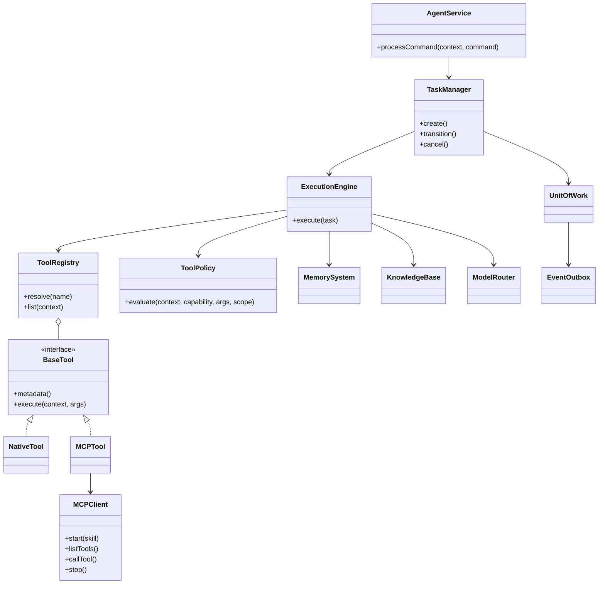

# NanamiGopher 核心类关系

> **状态**：Derived
> **来源**：[BackendDesign.md](BackendDesign.md)
> **最后核验**：2026-09-14

本文档只描述稳定接口与依赖方向，不维护所有实现方法。

## 依赖规则

- AgentService 是协议入口，不包含工具执行实现。
- TaskManager 是任务状态转换的唯一入口。
- ExecutionEngine 通过接口依赖 Tool、Memory、Knowledge 和 Model。
- ToolPolicy 在 Native/MCP 分流之前执行。
- MCPClient 只由 Python Tool 子系统管理。
- UnitOfWork 负责领域状态与 OutboxEvent 的一致提交。
