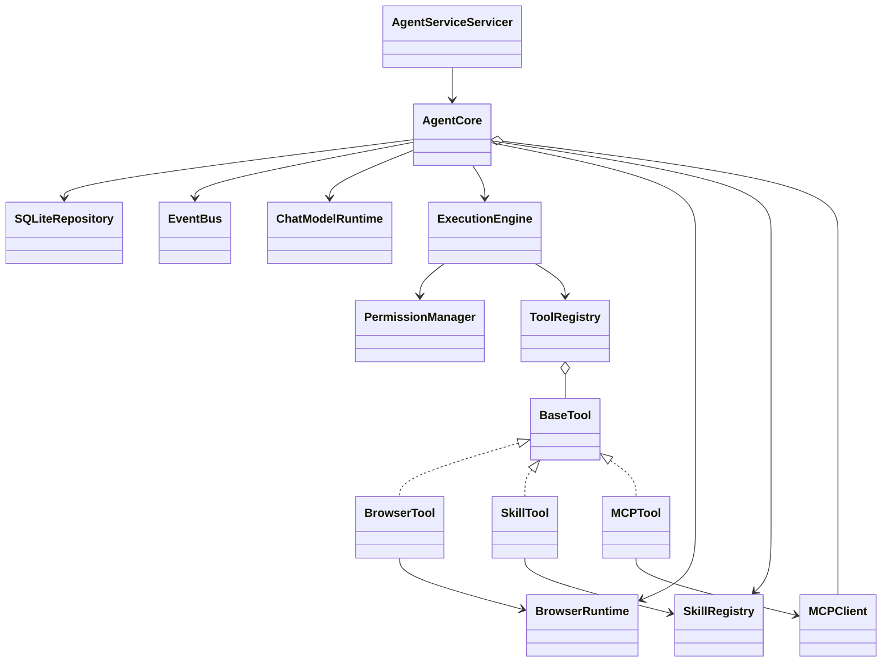

# NanamiGopher 当前核心类关系

> **状态**：Derived
> **来源**：[BackendDesign.md](BackendDesign.md) 与当前代码
> **最后核验**：2026-09-18

本文只画已存在的核心依赖。UnitOfWork、Outbox、持久调度器、Knowledge/Embedding 执行链和自动 Model Router 均为 Planned，不放入当前类图。

依赖规则：

- `AgentServiceServicer` 只做 Proto 转换和流桥接，领域写入委托给 `AgentCore`。
- `AgentCore` 是当前组合根；任务执行与审批 continuation 由它协调。
- `ExecutionEngine` 在调用任何 Native/MCP Tool 前统一执行参数验证和 `PermissionManager`。
- `SQLiteRepository` 是当前唯一领域持久化实现；正式 UnitOfWork/Outbox 尚未存在。
- Browser 与 Local Skill 通过 Tool 接口进入模型工具循环，不建立第二套执行或权限系统。
