# NanamiGopher 系统组件图

> 本文档描述了 NanamiGopher 系统的整体架构组件及其相互关系，涵盖前端、Go API Gateway、Python Agent Core、存储和 MCP 五大模块。

---

## 系统级组件图

```mermaid
graph TB
    subgraph Frontend["前端层 (Vue 3 + Electron)"]
        Sidebar["Sidebar.vue<br/>侧边栏导航<br/>可收起 64px/240px"]
        MainContent["MainContent.vue<br/>主工作区<br/>Tab 管理"]
        FileExplorer["FileExplorer.vue<br/>文件管理器<br/>可收起 48px/320px"]
        ChatArea["ChatArea.vue<br/>聊天区域<br/>消息渲染 + 输入"]
        InspectorPage["InspectorPage.vue<br/>实时监控面板<br/>WebSocket 推送"]
        OverviewPage["OverviewPage.vue<br/>总览仪表盘<br/>指标 + 日志"]
        ElectronApp["Electron App<br/>桌面壳进程<br/>IPC Bridge"]
    end

    subgraph Gateway["Go API Gateway (:8080)"]
        HTTPHandler["HTTP Handler<br/>REST API 路由<br/>/api/v1/*"]
        WSHandler["WebSocket Handler<br/>实时推送通道<br/>/ws/*"]
        GRPCServer["gRPC Server<br/>内部服务通信<br/>:8080 -> :8081"]
        MCPManager["MCP Server Manager<br/>启动/停止 MCP Server<br/>stdio 管理"]
        EventStream["Event Stream<br/>事件转发器<br/>Python → Frontend"]
        PermManager["Permission Manager<br/>权限校验中间件<br/>L1-L5 分级"]
    end

    subgraph AgentCore["Python Agent Core (:8081)"]
        TaskManager["TaskManager<br/>任务生命周期管理<br/>创建/执行/取消"]
        ExecEngine["ExecutionEngine<br/>工具执行引擎<br/>调度/流式/恢复"]
        SkillReg["SkillRegistry<br/>Skill 注册与发现<br/>Native + MCP"]
        MemSys["MemorySystem<br/>短期/对话/用户记忆<br/>检索与摘要"]
        KB["KnowledgeBase<br/>文档存储/检索/向量<br/>FTS5 + VectorDB"]
        ModelFactory["ModelProviderFactory<br/>多模型工厂<br/>Chat + Embedding"]
        EventBus["EventBus<br/>异步事件总线<br/>发布/订阅"]
        Observability["Observability<br/>追踪/指标/日志<br/>OpenTelemetry"]
        Recovery["ExecutionRecovery<br/>错误恢复策略<br/>retry/fallback/rollback"]
    end

    subgraph Storage["存储层"]
        SQLite["SQLiteStorage<br/>SQLite + FTS5<br/>默认存储引擎"]
        VectorDB["VectorStorage<br/>ChromaDB<br/>Phase 3 向量库"]
        FileStore["FileStorage<br/>本地文件系统<br/>工作区文件"]
        CredStore["CredentialStore<br/>AES-256 加密<br/>凭证管理"]
    end

    subgraph MCP["MCP 生态"]
        MCPClient["MCPClient<br>MCP 协议客户端<br/>stdio 通信"]
        MCPToolWrap["MCPToolWrapper<br/>MCP 工具适配器<br/>统一 BaseTool 接口"]
        SKILLParser["SKILL.md Parser<br/>解析 SKILL.md<br/>构建工作流定义"]
        ExternalMCP["外部 MCP Server<br/>第三方工具服务<br/>独立进程"]
    end

    subgraph LLM["外部模型服务"]
        OpenAI["OpenAI API<br/>gpt-4o / text-embedding"]
        Anthropic["Anthropic API<br/>claude-3.x"]
        Google["Google AI<br/>qwen2.5 / gemini"]
        LocalEmbed["本地嵌入模型<br/>BGE-M3 / OpenAI / GTE"]
    end

    %% 前端 → Gateway
    ElectronApp -->|"HTTPS REST"| HTTPHandler
    ElectronApp -->|"WebSocket"| WSHandler
    Sidebar --> MainContent
    Sidebar --> FileExplorer
    MainContent --> ChatArea
    MainContent --> InspectorPage
    MainContent --> OverviewPage

    %% Gateway → Agent Core
    HTTPHandler -->|"gRPC"| TaskManager
    HTTPHandler -->|"gRPC"| ModelFactory
    WSHandler --> EventStream
    GRPCServer --> TaskManager
    GRPCServer --> SkillReg
    GRPCServer --> EventBus

    %% Gateway 内部
    HTTPHandler --> PermManager
    EventStream --> WSHandler

    %% Agent Core 内部
    TaskManager --> ExecEngine
    ExecEngine --> SkillReg
    ExecEngine --> MemSys
    ExecEngine --> KB
    ExecEngine --> Recovery
    ExecEngine --> Observability
    ExecEngine -->|"publish"| EventBus
    TaskManager --> Observability
    TaskManager -->|"lifecycle"| EventBus
    MemSys --> KB
    SkillReg --> MCPClient

    %% Agent Core → Storage
    MemSys --> SQLite
    KB --> SQLite
    KB --> VectorDB
    FileStore -->|"workspace files"| ChatArea
    CredStore --> SQLite
    ModelFactory --> LocalEmbed

    %% Agent Core → MCP
    MCPClient -->|"stdio"| ExternalMCP
    SkillReg --> MCPToolWrap
    SKILLParser --> MCPToolWrap
    MCPToolWrap --> ExternalMCP

    %% Agent Core → LLM
    ModelFactory --> OpenAI
    ModelFactory --> Anthropic
    ModelFactory --> Google
    ModelFactory --> LocalEmbed

    %% 样式
    classDef frontend fill:#e3f2fd,stroke:#1565c0,stroke-width:2px
    classDef gateway fill:#fff3e0,stroke:#e65100,stroke-width:2px
    classDef agent fill:#e8f5e9,stroke:#2e7d32,stroke-width:2px
    classDef storage fill:#f3e5f5,stroke:#6a1b9a,stroke-width:2px
    classDef mcp fill:#fce4ec,stroke:#c2185b,stroke-width:2px
    classDef llm fill:#ede7f6,stroke:#4527a0,stroke-width:2px

    class Sidebar,MainContent,FileExplorer,ChatArea,InspectorPage,OverviewPage,ElectronApp frontend
    class HTTPHandler,WSHandler,GRPCServer,MCPManager,EventStream,PermManager gateway
    class TaskManager,ExecEngine,SkillReg,MemSys,KB,ModelFactory,EventBus,Observability,Recovery agent
    class SQLite,VectorDB,FileStore,CredStore storage
    class MCPClient,MCPToolWrap,SKILLParser,ExternalMCP mcp
    class OpenAI,Anthropic,Google,LocalEmbed llm
```



---

## 组件详细说明

### 前端层 (Vue 3 + Electron)

| 组件 | 技术栈 | 职责 | 通信方式 |
|------|--------|------|----------|
| **ElectronApp** | Electron 28+ | 桌面应用外壳，进程管理，IPC 桥接 | Node.js API |
| **Sidebar.vue** | Vue 3 Composition API | 左侧导航栏，可收起至 64px(图标) 或 240px(完整)，包含对话列表、Skill 列表、设置入口 | HTTP / WebSocket |
| **MainContent.vue** | Vue 3 Composition API | 主工作区，Tab 管理，承载 ChatArea/FileExplorer/InspectorPage | 内部路由 |
| **FileExplorer.vue** | Vue 3 + @vueuse/core | 右侧文件管理器，可收起至 48px(图标) 或 320px(完整)，文件树浏览、CRUD 操作 | HTTP / WebSocket 文件变更 |
| **ChatArea.vue** | Vue 3 + Marked.js | 聊天区域，消息渲染（Markdown/代码块/折叠卡片），用户输入框 | WebSocket 流式接收 |
| **InspectorPage.vue** | Vue 3 + ECharts | 实时监控面板，WebSocket 事件流展示，任务进度、工具调用、Token 消耗图表 | WebSocket 实时推送 |
| **OverviewPage.vue** | Vue 3 + ECharts | 总览仪表盘，系统指标、活跃任务、Skill 统计、审计日志概览 | HTTP API 轮询 |

---

### Go API Gateway 层

| 组件 | 技术栈 | 职责 | 通信方式 |
|------|--------|------|----------|
| **HTTP Handler** | Gin / Chi Router | REST API 路由分发，请求/响应序列化，中间件链（CORS、RateLimit、Auth） | HTTPS → gRPC |
| **WebSocket Handler** | gorilla/websocket | WebSocket 连接管理，消息广播，心跳检测，客户端订阅过滤 | WS → EventStream |
| **gRPC Server** | gRPC-Go + protobuf | 与 Python Agent Core 的内部通信，定义 TaskService / SkillService / MemoryService | gRPC → :8081 |
| **MCP Server Manager** | 进程管理 | 启动/停止/重启 MCP Server 进程，stdio 管道管理，生命周期监控 | stdio → External MCP |
| **Event Stream** | channel + broadcast | 接收 Python EventBus 事件，广播到所有 WebSocket 客户端 | gRPC → WS |
| **Permission Manager** | 中间件 | 权限校验 L1-L5，根据用户角色和任务模式决定允许/拒绝/需审批 | 拦截 HTTP/gRPC |

---

### Python Agent Core 层

| 组件 | 技术栈 | 职责 | 通信方式 |
|------|--------|------|----------|
| **TaskManager** | asyncio + FastAPI | 任务生命周期管理（创建/执行/取消/查询），任务队列调度 | gRPC ↔ Go Gateway |
| **ExecutionEngine** | asyncio + 流式生成器 | 工具执行调度，流式输出管理，错误恢复协调，上下文传递 | 调用 SkillRegistry |
| **SkillRegistry** | 插件式注册表 | Native Tool 注册/发现，MCP Server 集成，工具定义缓存 | 管理 BaseTool 实例 |
| **MemorySystem** | 分层记忆架构 | 短期记忆（最近 N 条）、对话记忆（摘要）、用户记忆（偏好），检索增强 | 读写 SQLite |
| **KnowledgeBase** | 文档检索系统 | 文档存储、向量检索、全文检索（FTS5）、重排序 | SQLite + VectorDB |
| **ModelProviderFactory** | 多模型适配层 | Chat 模型工厂（qwen2.5/gpt-4o/claude）、Embedding 工厂（BGE-M3/OpenAI/GTE） | HTTP → LLM API |
| **EventBus** | 异步事件总线 | 发布/订阅模式，异步事件队列，事件类型：task.started/tool.called/llm.token/task.completed/task.failed | 内部 → Go Gateway |
| **Observability** | OpenTelemetry | 分布式追踪、指标采集（Prometheus 格式）、结构化日志 | Prometheus / Jaeger |
| **ExecutionRecovery** | 恢复策略引擎 | 错误分类（超时/权限/数据损坏）、重试（指数退避）、回滚、降级、跳过 | 调用 ExecutionEngine |

---

### 存储层

| 组件 | 技术栈 | 职责 | 通信方式 |
|------|--------|------|----------|
| **SQLiteStorage** | SQLite + FTS5 | 默认存储引擎，关系数据持久化，FTS5 全文检索，事务管理 | SQL 查询 |
| **VectorStorage** | ChromaDB (Phase 3) | 向量数据库，语义检索，文档嵌入存储，相似度搜索 | HTTP API |
| **FileStorage** | 本地文件系统 | 工作区文件读写，文件变更监听，权限控制 | OS File API |
| **CredentialStore** | AES-256 加密 | 凭证安全存储，密钥轮换，加密/解密操作 | SQLite 后端 |

---

### MCP 生态层

| 组件 | 技术栈 | 职责 | 通信方式 |
|------|--------|------|----------|
| **MCPClient** | MCP SDK (Python) | MCP 协议客户端，stdio 管道通信，initialize/notifications/tools/calls | stdio → 外部进程 |
| **MCPToolWrapper** | 适配器模式 | 将 MCP 工具统一包装为 BaseTool 接口，参数转换，结果标准化 | 调用 MCPClient |
| **SKILL.md Parser** | YAML/Markdown 解析 | 解析 SKILL.md 规范文件，提取工具定义、参数 schema、权限要求 | 文件读取 |
| **External MCP Server** | 独立进程 | 第三方 MCP 工具服务，遵循 MCP Protocol，提供 tools/resources/prompts | stdio |

---

## 组件间通信矩阵

| 源组件 | 目标组件 | 协议 | 方向 | 说明 |
|--------|----------|------|------|------|
| ElectronApp | HTTP Handler | HTTPS/JSON | Frontend → Gateway | REST API 请求 |
| ElectronApp | WebSocket Handler | WSS/JSON | Frontend → Gateway | 实时事件订阅 |
| HTTP Handler | TaskManager | gRPC/protobuf | Gateway → AgentCore | 任务创建/查询 |
| HTTP Handler | ModelFactory | gRPC/protobuf | Gateway → AgentCore | 模型配置请求 |
| WebSocket Handler | Event Stream | 内部 channel | Gateway 内部 | 事件路由 |
| Event Stream | WebSocket Handler | 内部 channel | Gateway 内部 | 事件转发 |
| TaskManager | ExecutionEngine | asyncio call | AgentCore 内部 | 任务执行委托 |
| ExecutionEngine | SkillRegistry | 接口调用 | AgentCore 内部 | 工具解析 |
| ExecutionEngine | EventBus | 异步 publish | AgentCore 内部 | 事件发布 |
| MemorySystem | SQLiteStorage | SQL 查询 | AgentCore → Storage | 记忆持久化 |
| KnowledgeBase | SQLiteStorage | SQL + FTS5 | AgentCore → Storage | 文档存储/检索 |
| KnowledgeBase | VectorStorage | HTTP API | AgentCore → Storage | 向量检索 |
| SkillRegistry | MCPClient | 接口调用 | AgentCore → MCP | MCP 工具管理 |
| MCPClient | External MCP Server | stdio | AgentCore → MCP | 进程通信 |
| ModelFactory | OpenAI/Anthropic/Google | HTTPS/JSON | AgentCore → LLM | 模型 API 调用 |
| FileExplorer | FileStorage | HTTP API | Frontend → AgentCore | 文件操作 |

---

## 数据流架构

```
用户请求 → [Vue 3 + Electron]
           ↓ HTTPS / WebSocket
       [Go API Gateway :8080]
           ↓ gRPC
       [Python Agent Core :8081]
           ↓ SQL / HTTP / stdio
       ┌─────────────────────────────┐
       │  SQLite  │  VectorDB  │ MCP │
       └─────────────────────────────┘
           ↓ 事件回调
       [Go API Gateway] → WebSocket → [Vue 3 Inspector]
```
