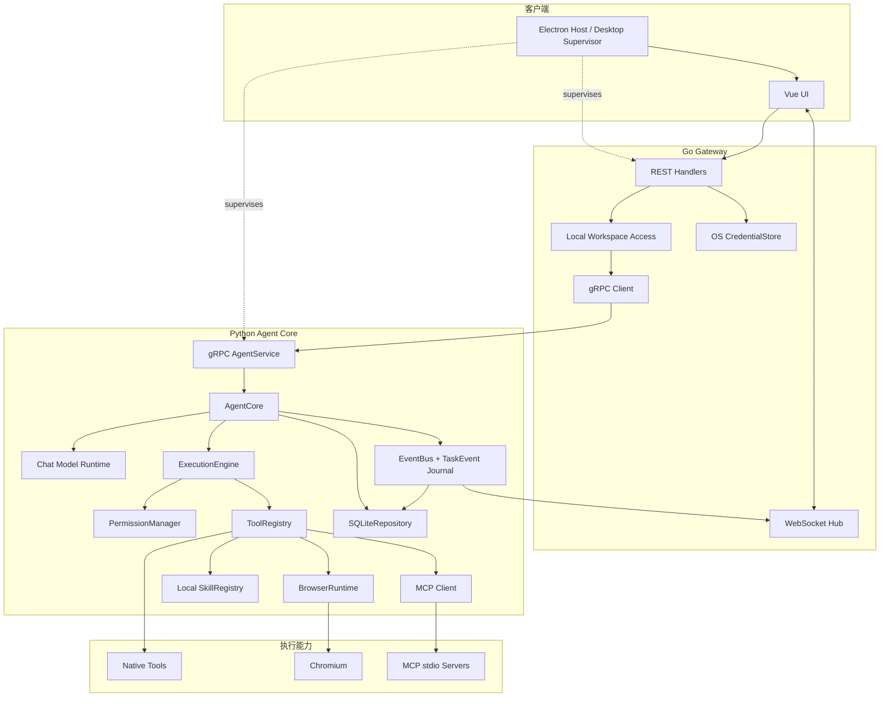

# NanamiGopher 当前组件图

> **状态**：Derived
> **来源**：[SystemDesign.md](SystemDesign.md)
> **最后核验**：2026-09-18

本文只展示当前通用 Agent 内核；PostgreSQL、向量索引、完整身份服务和分布式 MCP Worker 属于 Planned。

依赖约束：

- UI 只依赖公开 REST/WebSocket；Renderer 不获得文件系统或 Shell 权限。
- Go 不执行 Tool、不管理 MCP 子进程，也不写 Agent 领域状态。
- Python ToolRegistry 是 Native、Browser、Skill 和 MCP Tool 的统一入口。
- SQLite 是当前唯一业务数据库；Secret 值只由 Gateway CredentialStore 持有并按需同步到 Core 内存。
