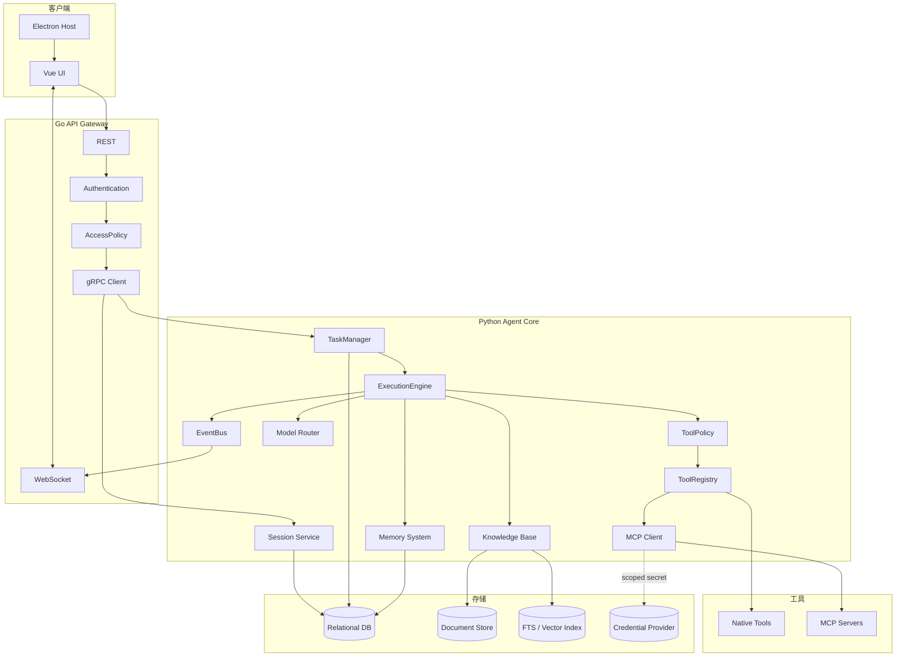
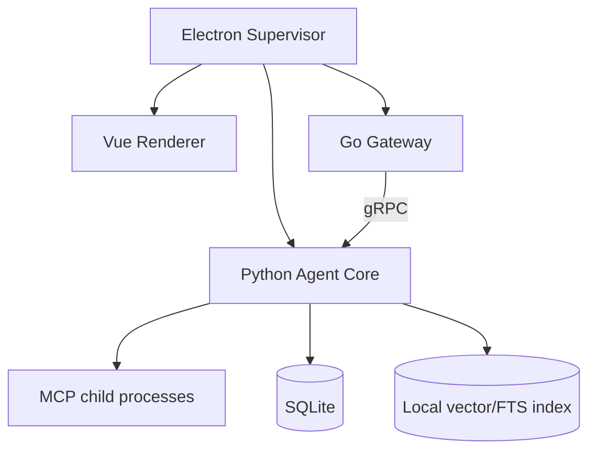
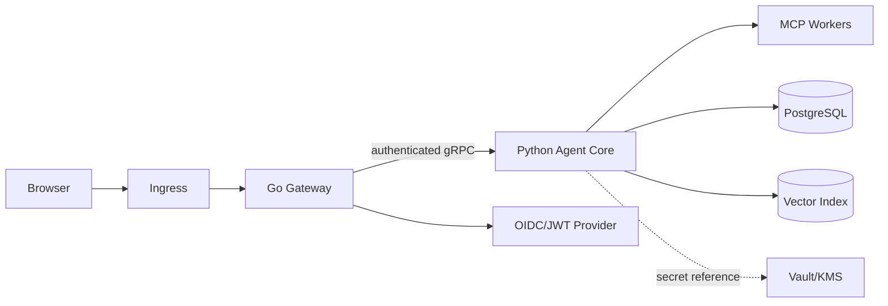

# NanamiGopher 组件图

> **状态**：Derived
> **来源**：[SystemDesign.md](SystemDesign.md)
> **最后核验**：2026-09-14

本文档只提供总体架构的图形视图；职责和约束以 SystemDesign 与 ADR 为准。

## 1. 逻辑组件

## 2. 桌面部署

## 3. 服务器部署

## 4. 依赖约束

- UI 只依赖公开 API 和事件契约。
- Go 不依赖具体 Tool 或 MCP Server 实现。
- Python ToolRegistry 是所有工具调用的唯一入口。
- MCP Server 不直接访问业务数据库。
- 派生索引不拥有原始文档或消息。
