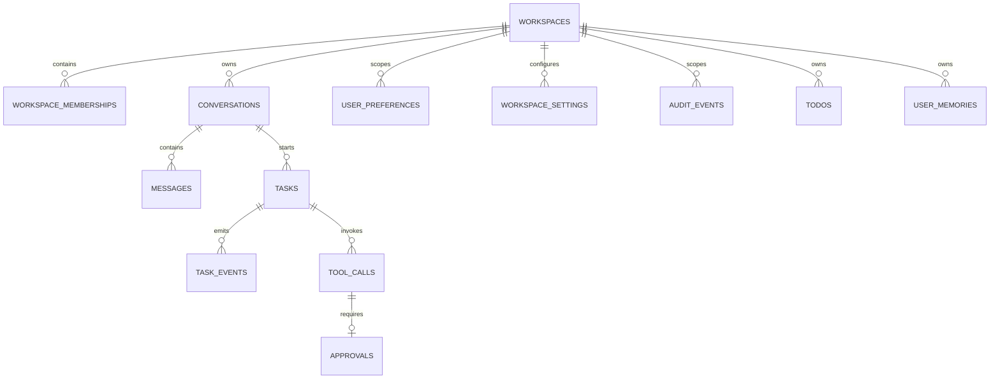

# NanamiGopher 当前 ER 图

> **状态**：Derived
> **来源**：[Database.md](Database.md) 与 `python/agent/repository.py`
> **最后核验**：2026-09-18

本图只包含当前 SQLite 表。目标 Skill 包、Workflow、Schedule、Document、索引、TaskRun 和 Outbox 见 Database 的 Planned 章节。

说明：

- 图中的 Task → Conversation、Task → Workspace 是当前逻辑归属；`tasks` 尚未声明相应数据库外键。
- Approval 通过唯一 `tool_call_id` 与 ToolCall 一对零或一关联。
- `task_events` 使用 `(conversation_id, sequence)` 保证当前会话内顺序唯一。
- Working Context 从 Messages 派生，不建立重复消息表。
