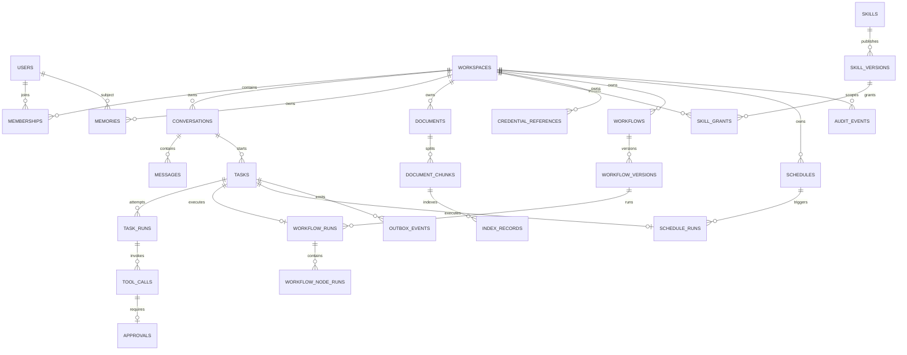

# NanamiGopher ER 图

> **状态**：Derived
> **来源**：[Database.md](Database.md)
> **最后核验**：2026-09-14

字段、约束和迁移以 Database 与实际 migration 为准；本文档不维护第二套字段表。

## 关系说明

- Workspace 是业务数据的统一归属边界。
- Message 是会话事实；Working Memory 不作为重复消息表。
- TaskRun 表示一次执行尝试，ToolCall 属于具体尝试。
- Approval 绑定 ToolCall，不是独立可任意创建的业务资源。
- DocumentChunk 是向量与全文索引的稳定来源。
- CredentialReference 不包含 Secret 值。
