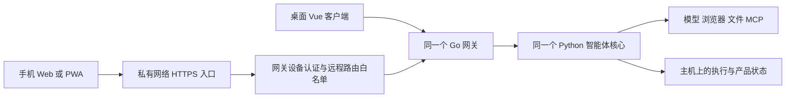

# 个人智能体手机远程访问设计

> 状态：规划中，首版范围待审阅。2026-10-09 本轮仅更新设计与路线图，未实现移动客户端、设备配对或远程入口。
> 权威范围：手机远程访问的产品范围、连接边界、交付顺序与验收。具体接口和数据字段在实施时分别进入 API、Proto 与数据库设计。

## 1. 使用方式

同一个人可以在电脑和手机上使用同一个智能体。电脑持有模型连接、浏览器、工作区文件和执行进程；手机负责发起任务、查看过程、处理审批和阅读结果。个人工作区提供项目或资料的上下文。手机是获准访问的设备，不是新的团队成员。

参考 Codex Remote 的手机发起、查看和批准主机任务的交互方式；MaigoKite 面向资料研究、文件整理、浏览器操作等通用任务。[OpenAI 官方介绍](https://developers.openai.com/blog/mastering-codex-remote-for-engineering)

首个场景：在手机上要求智能体阅读指定文件并整理结果；电脑开始执行；手机锁屏后任务继续；重新打开手机，查看待写入内容并批准；电脑完成写入，手机和桌面显示同一结果。浏览器任务在所用运行时已支持并通过验收后复用这一入口。

## 2. 首版范围

首版建议采用响应式 Web/PWA，以一台个人电脑作为执行主机，先验收一部已配对手机与桌面同时使用的场景。复用现有 Vue API 客户端、消息、活动和审批组件。PWA 可在支持的手机浏览器中添加到主屏幕；远程部署使用 HTTPS。[PWA 安装条件](https://developer.mozilla.org/en-US/docs/Web/Progressive_web_apps/Guides/Making_PWAs_installable)

| 能力 | 首版边界 |
|---|---|
| 连接电脑 | 用户在电脑启用远程访问，手机配对，电脑确认；可查看和撤销该设备 |
| 对话 | 查看现有会话、新建会话、发送文字，使用主机上已配置的模型 |
| 任务 | 查看运行、等待审批、完成和失败状态；显式停止任务 |
| 审批 | 展示实际操作、目标与参数，允许或拒绝；沿用核心服务的摘要值/版本/有效期检查 |
| 结果 | 阅读最终回复、活动详情、已有受控文件预览；Git 差异按需展示 |
| 断线 | 锁屏和网络切换不取消主机任务；回到前台后补齐历史、任务与审批状态 |
| 主机状态 | 显示可连接、重连中、不可达及最近同步时间；不可达时不能宣称任务已经停止 |

手机采用单栏：会话列表 → 对话与进度 → 按需展开操作详情。待审批操作有明确入口，不直接缩小桌面三栏布局。首次配对与设备管理保留在电脑设置中。未完成端到端实现的功能不展示可操作按钮。

以下放到后续：独立 Android/iOS App、锁屏系统推送、语音/拍照上传、系统分享入口、多主机切换、运行中补充指令/消息队列、远程桌面和浏览器视频控制、手机离线执行、免配置公网中继。首版只有前台状态提醒；不能把它描述成后台推送。

主机必须开机、可联网并保持智能体运行。桌面最小化后可以继续工作；关闭窗口后留在托盘运行的能力仍需补齐并验证。明确退出应用或电脑休眠会影响可用性，首版不提供远程唤醒或云端接管。

## 3. 连接与执行边界

- 手机消费现有 REST 和 界面事件 DTO，不连接 gRPC、不持有模型提供方敏感凭证、不运行第二套智能体主循环。
- 运行时恢复依据主机检查点；会话、审批和 UI 查询使用主机产品投影。移动端不同步 SQLite/检查点，不建立双主状态。
- 用户身份仍是同一个个人主体；设备身份单独用于配对、撤销和访问审计。现有 `workspace_id`、`principal_id` 保留，不能用客户端提交的主体冒充认证。
- 手机接入复用唯一 LangGraph Runtime，不扩展当前工具覆盖范围；迁移状态见 [运行时迁移说明](../development/RuntimeMigration.md)。

### 成熟实现选择

| 环节 | 建议 | 取舍 |
|---|---|---|
| 移动 UI | 复用 Vue，首版响应式 Web/PWA | 新增移动布局与安装元数据；共享业务协议与投影 |
| 跨网络连接 | 首先验证 Tailscale Serve 的私有 HTTPS 入口 | 复用网络连接和证书能力；手机与电脑需要安装、登录并连入受限私网 |
| 原生 App | 后续需要系统集成时评估 Capacitor | 可复用 Web 界面；原生发布、插件与真机验证仍有成本 |
| 事件与恢复 | 现有 REST/WSS、产品事件及所用运行时检查点 | 补齐一致性缺口，不建立同步框架或新的事件溯源系统 |
| 身份与批准 | 网络访问限制、薄设备会话层、现有 PermissionPolicy/审批 | 网络成员身份不能替代本应用的配对撤销和具体工具授权 |

Tailscale Serve 能把本机服务提供给 tailnet 内设备，并支持 HTTPS。本方案仅考虑私有 Serve，不启用公网 Funnel。它是首个连接验证方案，不写入核心服务依赖；其他已受保护的 HTTPS 入口应能使用相同应用协议。实施前需验证手机蜂窝网络、目标地区可达性、安装步骤和依赖许可。不能把需要私网客户端的版本宣传成免配置远程访问。[Tailscale Serve 文档](https://tailscale.com/docs/features/tailscale-serve)

Capacitor 提供将 Web 应用接入 iOS/Android 原生能力的现成容器，先作为后续候选，不在首版引入另一套移动 UI 技术栈。[Capacitor 文档](https://capacitorjs.com/docs)

### 设备访问

远程功能默认关闭。建议用一次性、短期有效的配对凭据发起连接，经电脑确认后颁发可撤销的设备会话。失效、已使用的配对凭据不能复用，配对尝试需要限流。具体会话组件先评估现有维护库；随机数、摘要值、TLS 使用标准实现，不自研密码协议或账户平台。

网页与 API 同源部署，设备会话采用 Secure/HttpOnly Cookie。状态修改请求校验 CSRF 和允许的 Origin；WebSocket 握手同样需要认证。长期凭据不进入二维码 URL、查询参数、localStorage 或日志。撤销设备后，拒绝该设备的新请求并关闭其现有事件连接；已启动的任务通过显式取消管理。

必须有独立的远程入口路由白名单，且身份验证覆盖全部远程请求。反向代理请求到达本机时，来源常表现为 loopback，不能因此免除认证，也不能只依靠客户端可伪造的转发头。gRPC 保持本机可见。

首版远程入口只提供会话、任务、审批及授权范围内结果读取。凭证修改、任意主机路径访问、MCP 安装和安全策略放宽不随整个现有 API 一起开放；手机选择已配置模型不需要拿到模型密钥。

## 4. 已有基础与实际缺口

以下为 2026-10-09 的代码检查结果，不代表远程功能已交付。

| 代码入口 | 可复用部分 | 实施前要解决的问题 |
|---|---|---|
| [router.go](../../gateway/internal/api/router.go) | 会话、任务、审批、文件与事件路由 | 主体固定为 `local-user`；Origin 限制不是设备认证，没有配对或撤销 |
| [message_handler.go](../../gateway/internal/api/message_handler.go) | 返回任务 ID，后台消费核心服务流 | 没有按客户端命令 ID 去重；手机请求超时后重试可能新建重复任务 |
| [grpc_server.py](../../python/agent/grpc_server.py) | `ProcessMessage` 的运行任务独立于调用方连接 | 要实测手机断线、网关断开与核心服务重启的不同结果 |
| [approval_handler.go](../../gateway/internal/api/approval_handler.go) | 现有决定接口、版本校验与恢复入口 | 使用 `BroadcastEvent` 丢弃核心服务持久事件 ID/sequence；必须与普通消息转发一致 |
| [task_handler.go](../../gateway/internal/api/task_handler.go) 和 [session.ts](../../web/src/stores/session.ts) | 历史读取、连接后补拉、按 ID 去重 | 历史单次上限 1000；缺少完整分页，实时事件推进最大游标可能越过未补齐缺口 |
| [client.ts](../../web/src/api/client.ts) | 集中的 API Client 和稳定 DTO | 加入设备会话和过期处理、移动前后台重连；保持与 Electron 运行环境兼容 |
| [main.ts](../../web/src/electron/main.ts) | Electron 持有本地进程 | 非 macOS 关闭所有窗口会退出；需明确托盘继续运行与主动退出的行为 |

手机连接断开只影响观察，不触发取消。停止请求到达主机、且运行清理结束后，才显示已停止；未收到确认时，显示状态待确认。审批请求网络超时后，先查询当前状态，再决定是否重试。禁止缓存并自动提交离线批准。

发送任务时，主机需要持久化客户端命令 ID 与任务 ID 的去重关系，重试复用同一 ID。同 ID、不同内容的请求返回冲突。此范围仅保证重复提交消息不会重复创建任务，不承诺工具副作用恰好一次（exactly-once）。

桌面与手机同时批准同一操作时，只允许一个有效决定生效，另一端刷新已处理状态。重连游标记录连续已确认事件；补拉期间缓存并合并实时事件，不能仅凭最大已见 sequence 判断历史已补齐。沿用现有事件表，验收覆盖超过单页的历史和补拉期间的新事件。

## 5. 开发顺序与验收

| 顺序 | 交付内容 | 验收条件 |
|---|---|---|
| R0 可靠性 | 修复审批事件转发、完整历史补拉、消息提交去重；验证所用运行时取消与审批恢复 | 桌面回归通过；重复消息不新建任务；超过 1000 条事件无缺口、无重复活动 |
| R1 连接 | 私有 HTTPS 验证、同源静态页面、设备配对/会话/撤销、远程路由限制 | 未配对、过期和已撤销设备不可访问；本地模式正常；撤销关闭活动连接 |
| R2 手机操作 | 移动会话、任务、审批、结果界面；主机关闭窗口留后台的明确交互 | 手机发起文件任务、电脑执行、手机批准、两端结果一致；两端同时决定只生效一次 |
| R3 真机交付 | PWA 安装、前后台恢复、连接状态和最小引导 | Android Chrome 与 iOS Safari 真机检查；Wi-Fi/蜂窝切换、锁屏、主机不可达后重连通过 |

必须完成的端到端场景：

1. 手机发送任务后立即断网，主机继续执行；恢复连接后读到同一任务结果，重试不重复启动。
2. 手机锁屏期间任务进入审批，回到前台可见；重复点击或桌面同时操作不会重复执行。
3. 等待文件写入审批时真正重启核心服务，再由手机批准；仅对已验证支持恢复的工具与运行时承诺续跑。
4. 模型流或可取消工具运行中从手机停止，主机清理结束再发布终态，此后不产生该任务的新执行事件；同步线程工具限制必须如实显示。
5. 事件积累超过 1000 条，补拉过程中还有新事件，两端最终消息、活动、审批和任务状态一致。
6. 撤销手机后已有 WSS 关闭、后续读写被拒绝；桌面与已经运行的任务继续按既定策略工作。
7. 关闭桌面窗口、主动退出、主机休眠分别验证；手机仅对可达主机展示实时状态，未确认的发送或停止不伪装为成功。

开发测试可使用源码启动主机。面向普通用户交付还依赖现有桌面安装与运行时 bundling 验收；PWA 构建成功不能代替桌面安装包可用。系统推送和免配置连接在首版数据反馈后单独确定范围。
