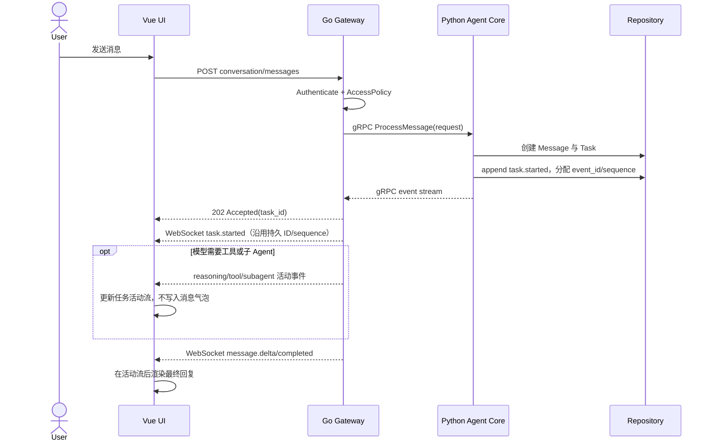
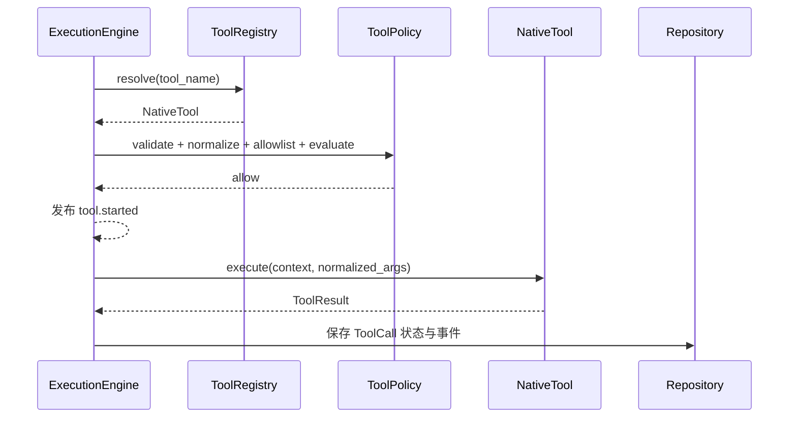
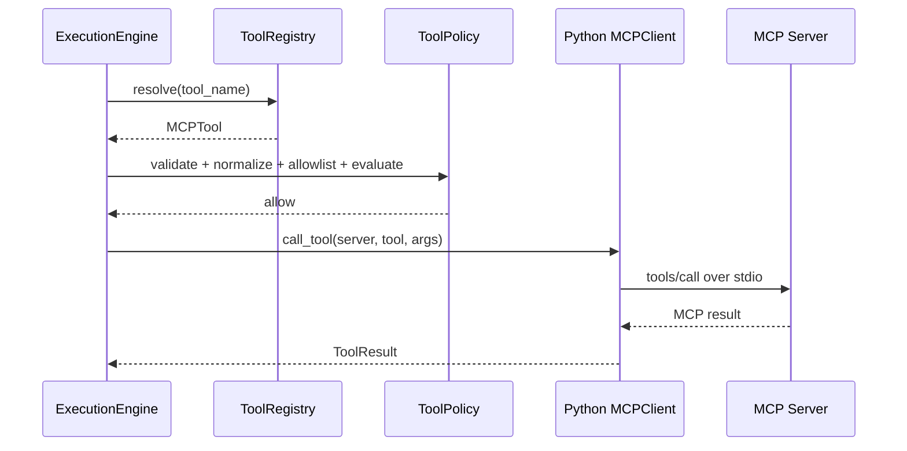
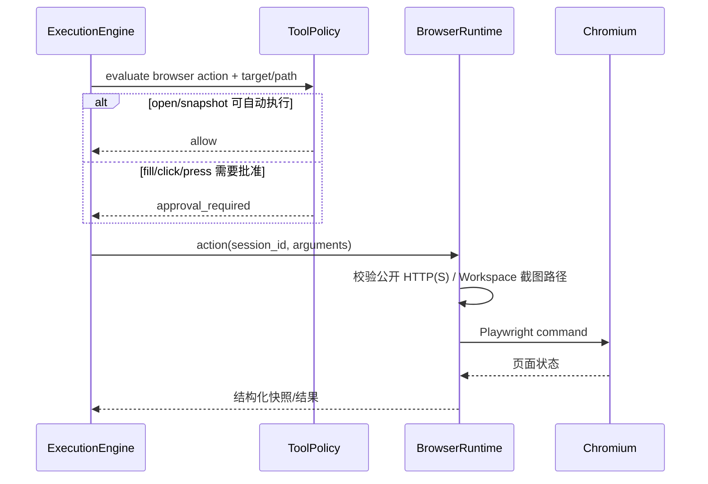
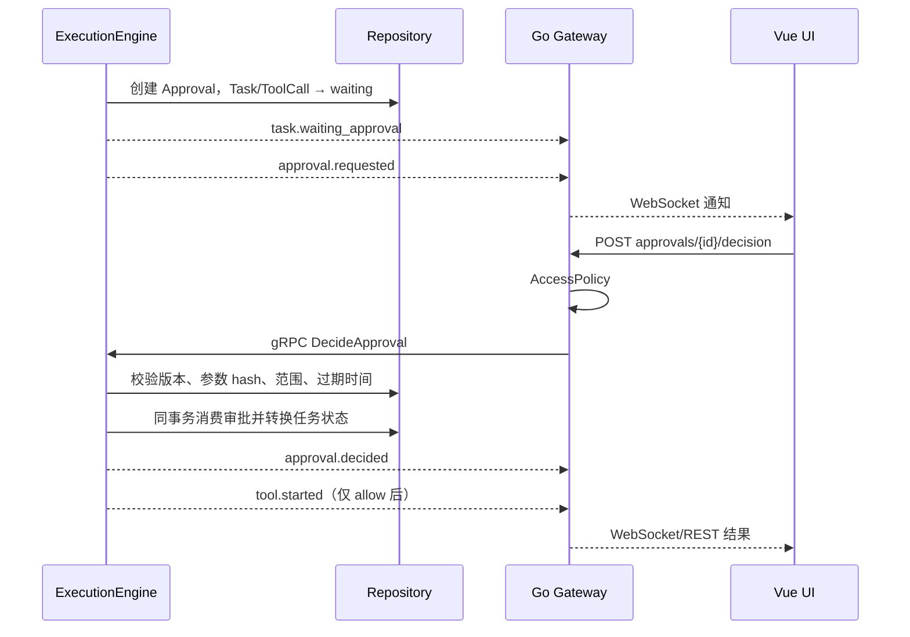
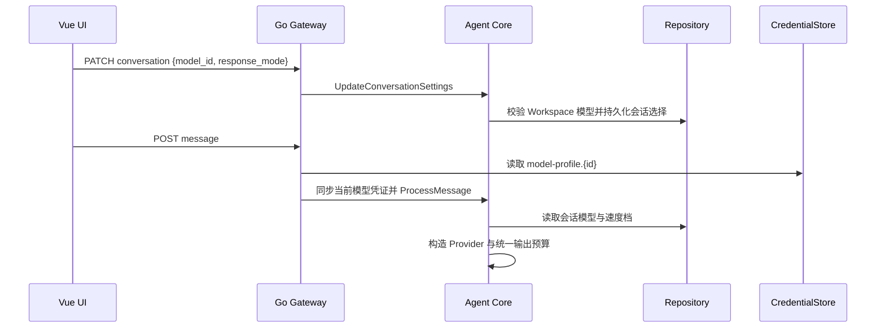
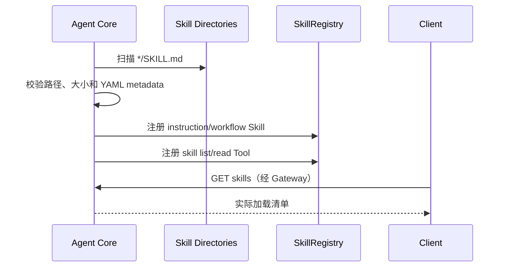
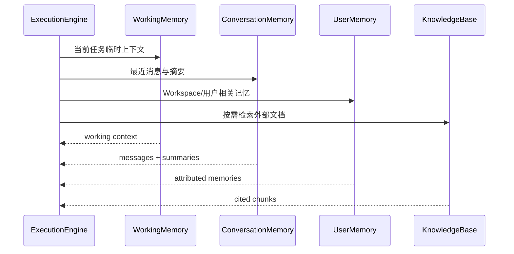
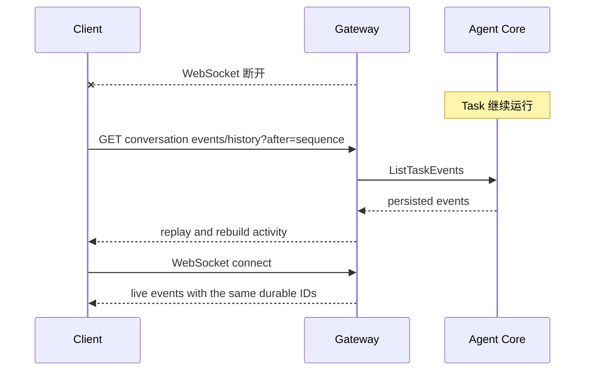
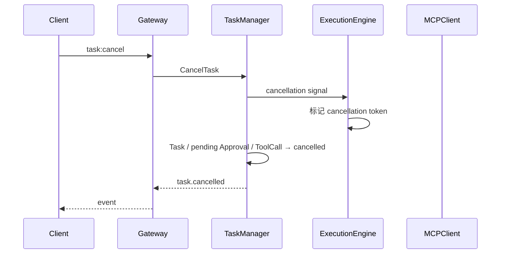

# NanamiGopher 关键时序

> **状态**：Derived
> **来源**：[SystemDesign](SystemDesign.md)、[BackendDesign](BackendDesign.md)、[API](API.md)
> **最后核验**：2026-09-18

时序图不单独定义 endpoint、字段或权限矩阵。

## 1. 发送消息

`message.*` 只表示面向用户的回答；模型主动给出的过程说明、工具调用和子 Agent 生命周期分别使用 `reasoning.*`、`tool.*`、`subagent.*`。隐藏思维链不进入事件或界面。

## 2. Native Tool 调用

## 3. MCP Tool 调用

## 3.1 Browser Tool 调用

## 4. 审批

### 4.1 会话模型与速度选择

### 4.2 Workspace 文件与 Diff

文件树、内容预览和 Git Diff 均为 Gateway 只读查询。变更列表只读取一次 Git 状态，用户选中文件后再按需生成该文件 Diff。Gateway 在访问文件系统或执行只读 Git 命令前，先完成 Workspace AccessPolicy 和根目录路径解析；渲染进程不获得 Node 文件系统或 Shell 能力。

## 5. Skill 发现（Current）

安装、签名、版本回滚和 Workspace Grant 属于 Planned，不得从此 Current 流程推断已经实现。

## 6. Memory 检索（Planned）

## 7. 断线与恢复

当前客户端在 WebSocket 建立后按最后 sequence 再补拉一次，并按 event ID 去重，因此普通连接窗口可恢复。历史读取与订阅仍不是服务端原子操作，且单页上限为 1000；目标协议是连接携带 `after_sequence`，由 Gateway 分页补发后注册实时订阅。

Core 重启时：具备持久 continuation 且不依赖易失资源的 `waiting_approval` 保持等待；Browser session 相关审批会被拒绝并转为 `interrupted`。其他非终态任务若没有安全 continuation，也转为 `interrupted` 并产生事件。

## 8. 取消

模型流和原生 Tool 在边界检查取消。第三方 MCP 是否能立即中止取决于其 transport/实现；完整取消与超时契约仍是 Phase 1 发布阻塞项。
