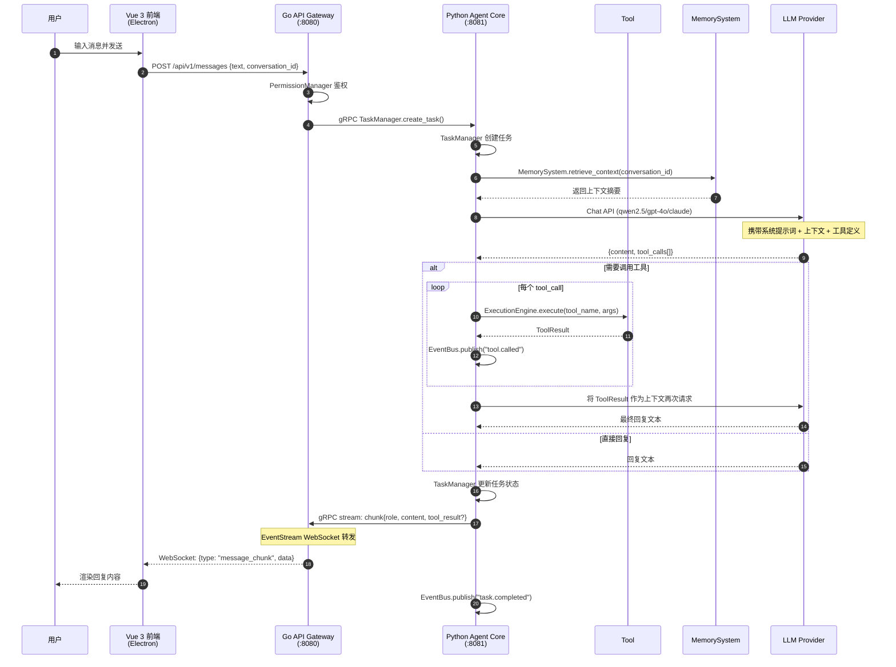
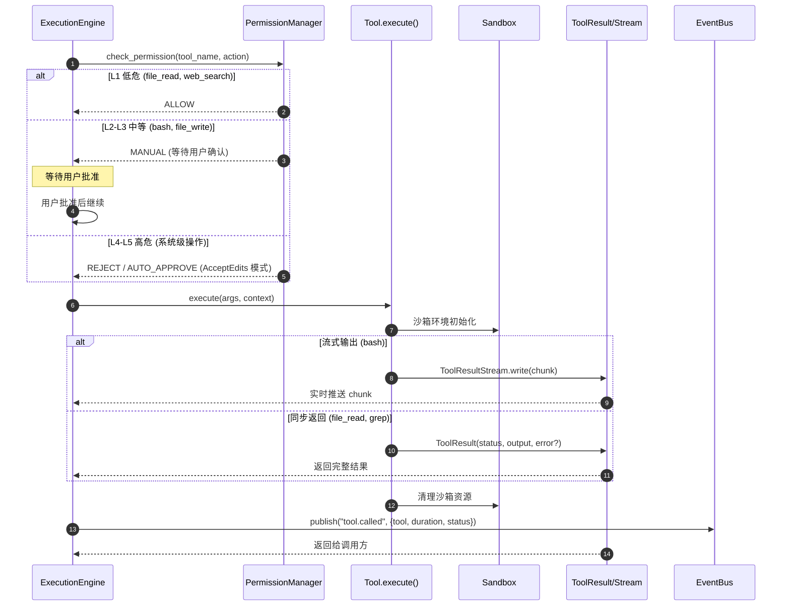
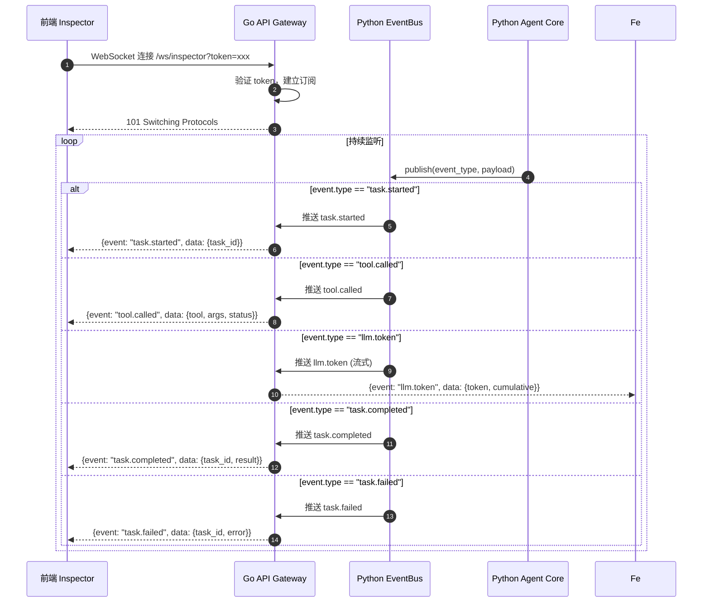
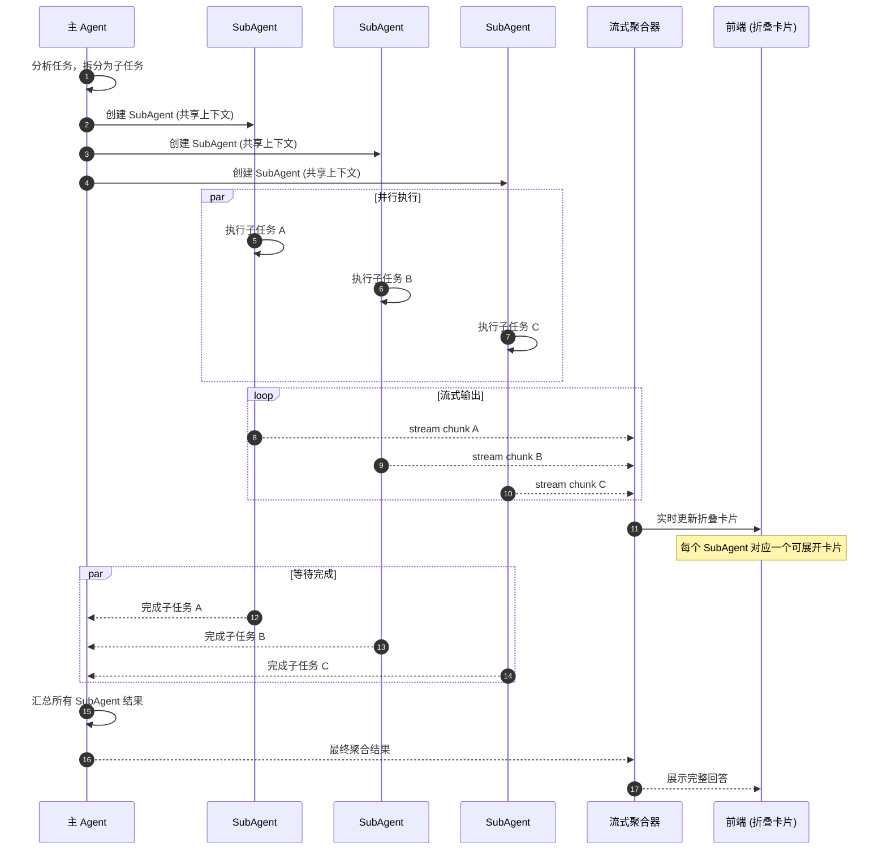
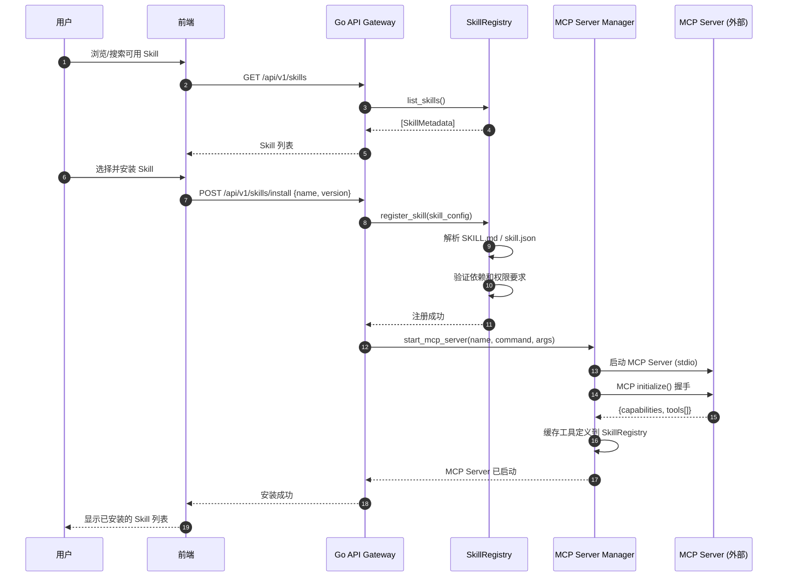
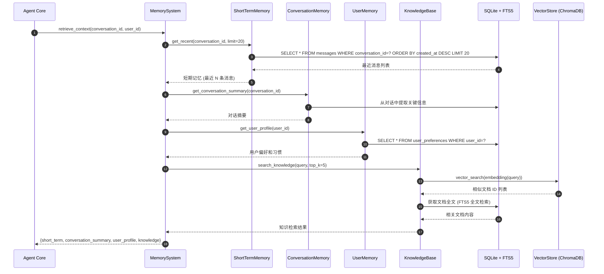
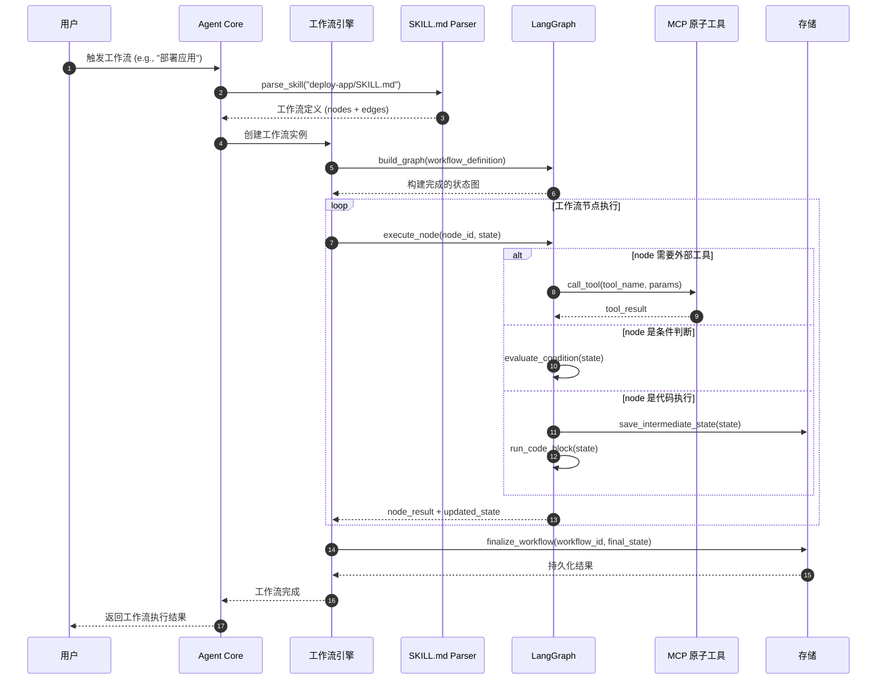
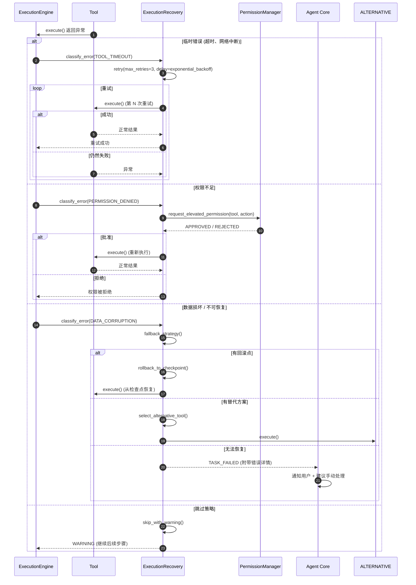

# NanamiGopher 系统时序图

> 本文档描述了 NanamiGopher 系统中各组件之间的交互时序，涵盖消息处理、工具调用、事件推送、SubAgent 编排、Skill 安装、记忆检索、工作流执行和错误恢复等核心流程。

---

## SEQ-01: 用户发送消息到收到回复的完整流程

---

## SEQ-02: 工具调用流程

---

## SEQ-03: WebSocket 事件推送流程

---

## SEQ-04: SubAgent 并行执行流程

---

## SEQ-05: Skill 安装流程

---

## SEQ-06: 记忆检索流程

---

## SEQ-07: 工作流执行流程

---

## SEQ-08: 错误恢复流程

---

## 附录：事件类型速查

| 事件名称 | 来源 | 用途 |
|---------|------|------|
| `task.started` | TaskManager | 通知前端任务已开始 |
| `tool.called` | ExecutionEngine | 记录工具调用详情 |
| `llm.token` | LLM Stream | 实时流式推送 Token |
| `task.completed` | TaskManager | 任务完成通知 |
| `task.failed` | ExecutionRecovery | 任务失败通知 |
| `permission.requested` | PermissionManager | 权限审批请求 |
| `skill.installed` | SkillRegistry | Skill 安装完成 |
| `workflow.node.executed` | LangGraph | 工作流节点执行记录 |
