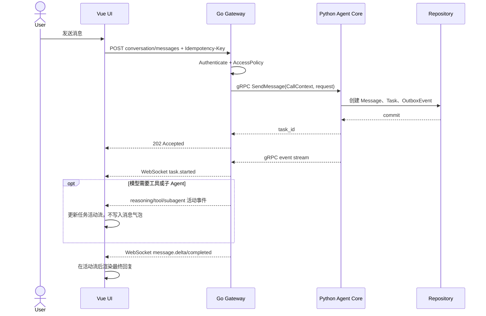
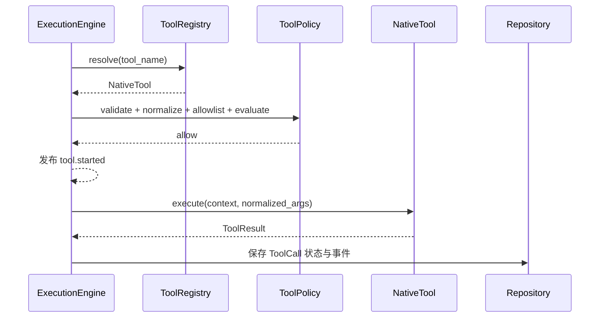
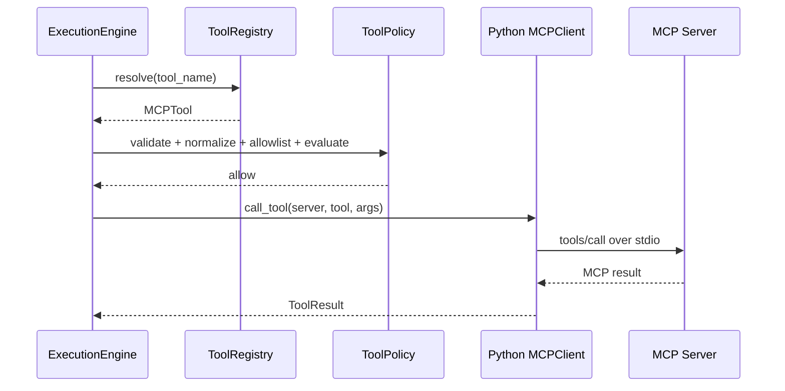
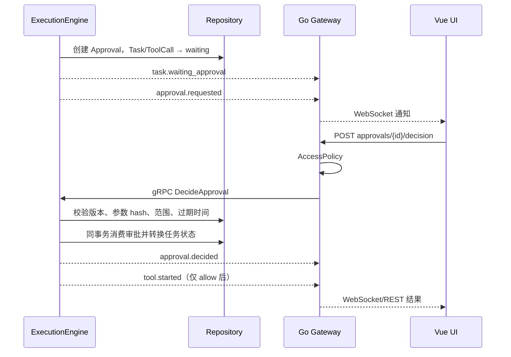
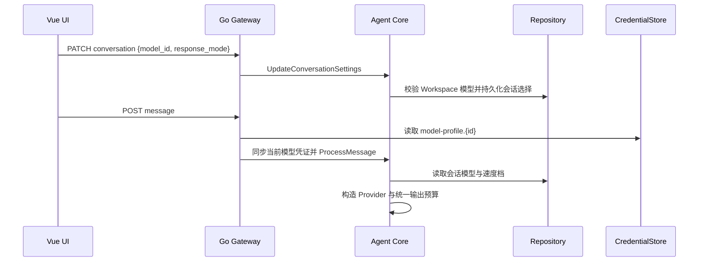
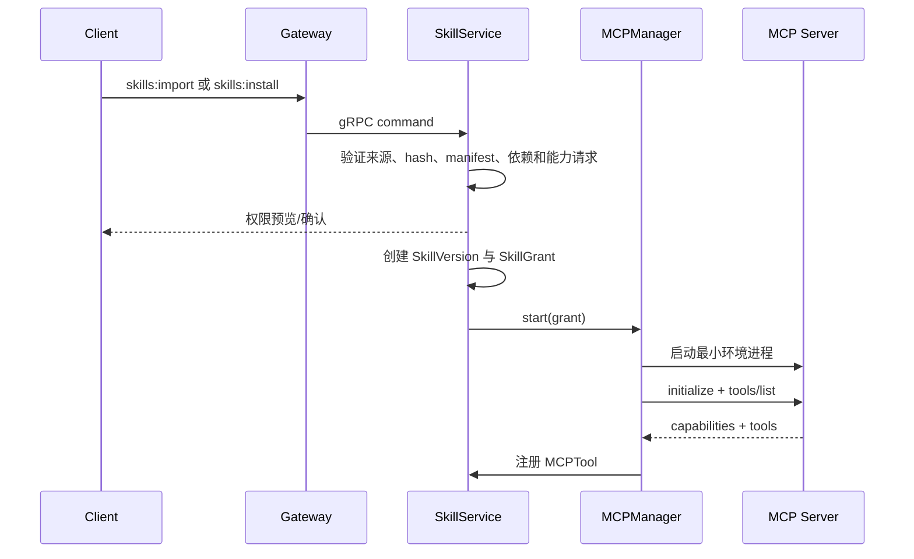
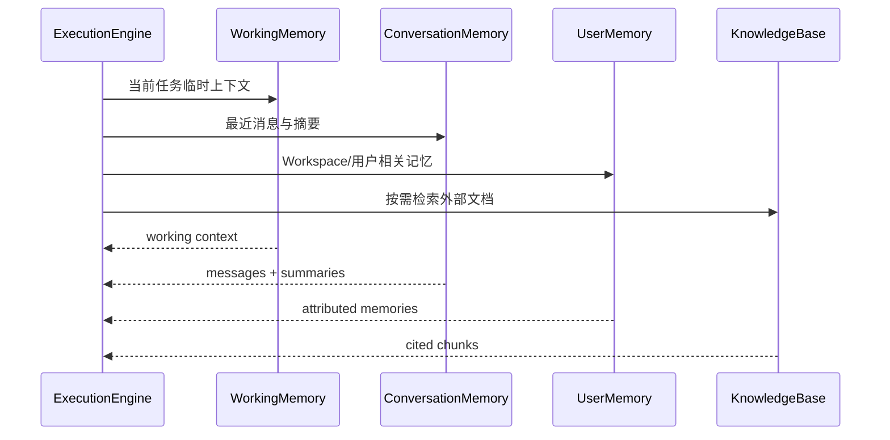
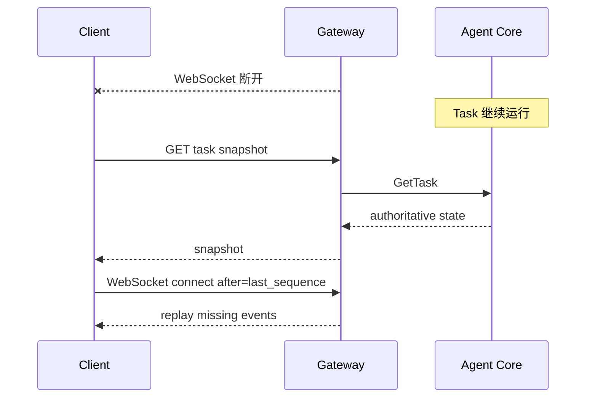
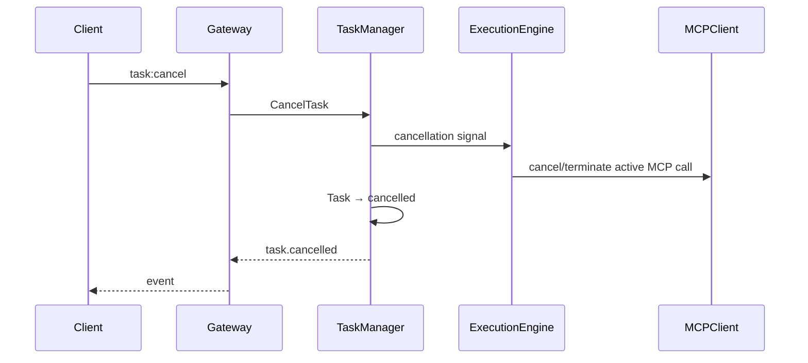

# NanamiGopher 关键时序

> **状态**：Derived
> **来源**：[SystemDesign](SystemDesign.md)、[BackendDesign](BackendDesign.md)、[API](API.md)
> **最后核验**：2026-09-14

时序图不单独定义 endpoint、字段或权限矩阵。

## 1. 发送消息

`message.*` 只表示面向用户的回答；模型主动给出的过程说明、工具调用和子 Agent 生命周期分别使用 `reasoning.*`、`tool.*`、`subagent.*`。隐藏思维链不进入事件或界面。

## 2. Native Tool 调用

## 3. MCP Tool 调用

## 4. 审批

### 4.1 会话模型与速度选择

### 4.2 Workspace 文件与 Diff

文件树、内容预览和 Git Diff 均为 Gateway 只读查询。变更列表只读取一次 Git 状态，用户选中文件后再按需生成该文件 Diff。Gateway 在访问文件系统或执行只读 Git 命令前，先完成 Workspace AccessPolicy 和根目录路径解析；渲染进程不获得 Node 文件系统或 Shell 能力。

## 5. Skill 导入与安装

## 6. Memory 检索

## 7. 断线与恢复

## 8. 取消

