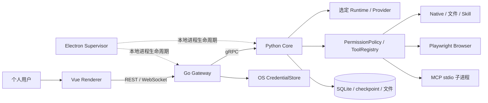

# 系统设计

> 权威范围：个人智能体的系统边界、组件所有权与运行形态。
> 详细实现分别由后端、前端、API、数据库和智能体运行时文档负责；本页不重复其字段、状态机或配置。

## 1. 产品范围与原则

MaigoKite 是本地优先、用户可控的个人通用智能体，为用户选定的工作流提供定制能力，不建设通用智能体平台、团队 SaaS 或编码专用产品。产品范围见 [产品愿景](../project/Vision.md)，验收见 [需求与验收](../requirements/RequirementList.md)。

- 副作用由用户权限模式与审批控制，模型不能自授权。
- 每个进程、运行状态和共享资源只有一个明确所有者。
- 成熟基础设施优先：运行时、模型提供方、MCP、浏览器、取消、持久执行不无必要自研。
- 默认本地数据；云模型、联网与未来远程访问显式启用。
- 机器契约和实际代码优先，Markdown 不维护另一套结构定义。

## 2. 组件与依赖方向

| 组件 | 负责 | 不负责 |
| --- | --- | --- |
| Vue | 对话、设置、文件、活动检查与审批交互 | 最终授权、Node/Shell/文件系统权限 |
| Electron | 安全窗口、白名单 IPC、桌面子进程启动和关闭 | 工具、智能体编排或业务状态 |
| Go 网关 | REST/WS、身份/资源归属、限流、凭证边界、gRPC 桥接 | MCP/工具执行、智能体主循环、业务表写入 |
| Python 核心服务 | 产品命令、策略、工具/模型提供方资源、业务持久化与事件投影 | 公网服务、第二套通用智能体框架 |
| 成熟运行时 | 新路径模型循环、工具编排、HITL 与检查点 | MaigoKite 用户审批 UX、安全审计和业务查询 |

普通聊天默认 legacy，显式 LangGraph 路径已新增现有注册工具的公开转换接线，尚未完成验收。旧主循环是待退役兼容路径，不是目标架构。实际范围与状态所有权见 [智能体运行时设计](AgentRuntime.md)。

## 3. 工作区与数据

工作区是个人项目、文件和资料边界。现有 `personal/team` 数据值与成员关系表保留兼容，不代表继续建设团队管理；当前没有独立 User/Team 管理 API。手机与桌面访问同一用户数据，未来配对设备身份与业务成员关系分开。

SQLite 是当前唯一业务库，领域写入由 Python Repository 管理。敏感凭证值在 OS 凭证存储，受控同步到核心服务内存，不进入普通配置。模型执行检查点与产品业务库用途不同，不能双向同步成两套执行事实来源。

消息和原始材料是事实来源；摘要、搜索与未来索引是派生数据。记忆 CRUD 不等于自动长期记忆，向量嵌入/索引尚未接线。数据约束见 [数据库设计](Database.md)。

## 4. 通信与信任边界

| 边界 | 当前协议 / 契约 |
| --- | --- |
| UI ↔ 网关 | HTTP/WebSocket；[API 设计](API.md) 与机器结构定义 |
| 网关 → 核心服务 | gRPC；`proto/agent.proto` |
| 核心服务 ↔ MCP | 当前 stdio；[MCP](../agent-capabilities/mcp/mcp-integration.md) |
| 核心服务 → 模型提供方 | 复用模型提供方库；[模型接入](../agent-capabilities/models/model-routing.md) |
| 核心服务 → 存储 | Repository / LangGraph checkpointer，分别管理业务与执行状态 |

请求必须依次经过身份/工作区 AccessPolicy、Python ToolPolicy、实际资源边界与 hard-deny。网关允许不能跳过工具策略，技能也不能扩大授权。风险与模式的唯一矩阵见 [工具权限](../agent-capabilities/security/tool-permission.md)。

## 5. 本地运行与关闭

桌面模式为 Electron + loopback 网关 + loopback gRPC 核心服务，MCP 子进程由核心服务持有。端口来自配置，不是架构常量。桌面进程监督器协调退出，核心服务等待活动运行实例清理后关闭依赖；不能先标记 cancelled 再遗留后台执行。

当前尚未形成干净机器安装包的完整 runtime bundling 验收。本地 loopback/Origin 边界也不能替代设备认证。构建、资源打包和发布阻塞仅在 [构建与发布指南](../deployment/ReleaseGuide.md) 维护。

历史多人服务器、PostgreSQL、Kubernetes 和分布式 Worker 不进入个人产品路线，也不是手机访问个人电脑的前置条件。当前 Docker 配置不是可用发行承诺。

## 6. 恢复与未来远程访问

WebSocket 是事件通道，不是事实来源。UI 读取持久事件并去重；连接中断不自动取消主机任务。新路径恢复看检查点，旧路径只保留安全续接数据的有限审批恢复；浏览器 session 是易失资源，不能据此承诺重启续跑。详细限制见 AgentRuntime 和 API。

手机 Web/PWA 为规划中，通过受保护 HTTPS 入口访问同一网关；不引入另一套运行时，也不能利用反向代理落到 loopback 就免认证。当前没有设备配对认证，不得直接公开本地端口。连接方案、权限和 R0–R3 验收仅由 [手机远程访问](RemoteAccess.md) 定义。

## 7. 专项入口

- [后端设计](BackendDesign.md)、[前端与桌面交互设计](FrontendDesign.md)
- [API 设计](API.md)、[数据库设计](Database.md)、[智能体运行时设计](AgentRuntime.md)
- [安全边界](../ops-security/Security.md)、[工具权限](../agent-capabilities/security/tool-permission.md)
- [交付路线与状态](../project/Roadmap.md)、[架构决策](../reference/Decisions.md)

只有明确的产品需求才扩展能力；工作流、子智能体、远程 MCP 等候选不能因预留类、目录或 UI 页面就标为已实现。
