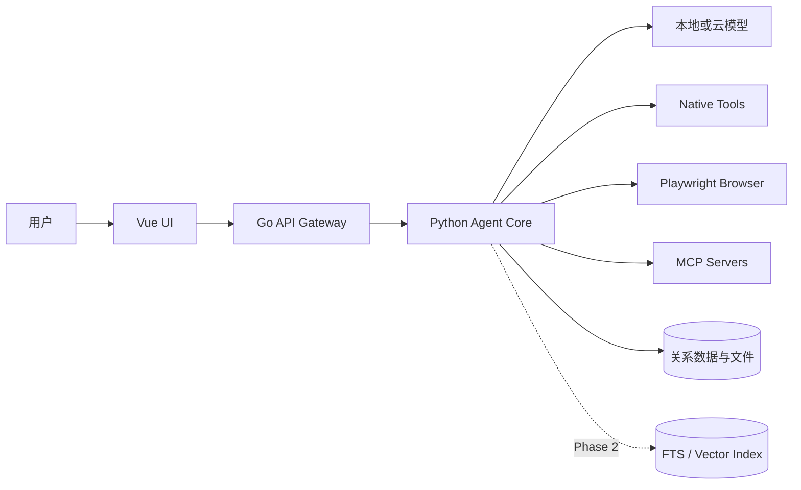
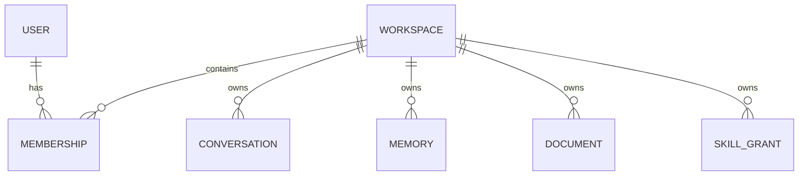

# NanamiGopher 系统设计

> **状态**：Current
> **架构版本**：v1
> **最后核验**：2026-09-18
> **权威范围**：系统边界、组件职责、依赖方向、运行形态

## 1. 系统目标

NanamiGopher 是本地优先、可扩展、用户可控的通用 AI Agent。个人空间和团队空间使用同一套领域模型与业务代码；本地桌面和服务器部署通过基础设施适配器处理差异。

核心原则：

1. 用户对副作用操作保持最终控制权。
2. 每个进程、状态和外部资源只有一个所有者。
3. 默认本地存储；联网能力和云模型显式启用。
4. 机器契约优先，Markdown 不维护字段副本。
5. 消息和原始文档是事实来源，摘要与索引可重建。

相关决策见 [Decisions](../reference/Decisions.md)。

## 2. 系统上下文



## 3. 组件职责

### 3.1 Vue UI

- 对话、Workspace、文件、设置和 Inspector 交互。
- 消费 REST 与 WebSocket 契约。
- 展示审批内容，但不作最终权限判定。

### 3.2 Electron Host

- 提供安全窗口、系统集成和白名单 IPC。
- 桌面模式下作为 Runtime Supervisor，启动、监控并关闭 Go 与 Python。
- 不实现会话、工具、记忆或权限业务逻辑。

### 3.3 Go API Gateway

- REST、WebSocket、认证、限流和输入边界。
- 执行 `AccessPolicy`：判断主体能否访问指定 Workspace 资源。
- 作为 gRPC Client 向 Python 提交命令并转发事件。
- 不执行 Tool，不维护 ToolRegistry，不启动 MCP Server，不直接写 Agent 领域状态。

### 3.4 Python Agent Core

- 会话执行、任务状态机、模型配置选择和上下文组装。
- 任务、审批、持久事件和 Tool 活动事件生产。
- 执行 `ToolPolicy`，管理 ToolRegistry、Native Tool 和 MCPClient。
- 是会话、消息、任务、审批、工具调用、记忆和运行记录的领域写入者。

### 3.5 Tool 系统

```text
ExecutionEngine
    └── ToolRegistry
        ├── NativeTool  → Python 进程内执行（含 BrowserTool / SkillTool）
        └── MCPTool     → MCPClient → 独立 MCP Server
```

Runtime 内核不是 Tool。Native、Browser、Skill 与 MCP Tool 共享参数校验、权限判断、结果和审计入口；取消在任务与 Tool 边界生效，第三方 MCP 调用的强制抢占仍有限制。BrowserRuntime 由 Core 持有，页面会话只通过不透明 `session_id` 暴露；本地 Skill 当前只提供声明式指令，不执行包内任意代码。完整规范见 [MCP](../agent-capabilities/mcp/mcp-integration.md) 和 [Tool Permission](../agent-capabilities/security/tool-permission.md)。

### 3.6 数据与索引

- 当前 SQLite 保存 Workspace、Membership、会话、消息、任务、TaskEvent、ToolCall、审批、偏好、设置、审计、Todo 和显式 User Memory。
- 当前实现只支持 SQLite；Repository 保留替换边界，PostgreSQL 属于团队部署阶段的 Planned 能力。
- 原始文档、FTS、Embedding 和向量库属于 Phase 2；接入后必须将索引视为可重建派生数据。
- Secret 值不存入业务数据库，见 [Security](../ops-security/Security.md)。

## 4. Workspace 模型

以下是个人/团队共用领域模型的目标形态；当前只实现 Workspace、`workspace_memberships` 和 Workspace 作用域资源，没有独立 User/Team 管理 API：



- Personal Workspace 通常只有一个 Owner。
- Team Workspace 通过 Membership 支持多个成员和角色。
- 业务 API 始终在 Workspace 上下文中工作，不维护两套个人/团队接口。

## 5. 通信边界

| 边界 | 协议 | 方向 | 权威契约 |
|---|---|---|---|
| UI ↔ Go | HTTPS / WebSocket | 双向 | OpenAPI / Event Schema |
| Go → Python | gRPC | Go Client → Python Server | Proto |
| Python ↔ MCP | MCP stdio（Current） | Python Client ↔ Tool Server | MCP 协议 |
| Python → Model | Provider API | 出站 | Provider Adapter |
| Python → Storage | Repository | 内部 | Database / Migration |

当前版本 MCP 只承诺 stdio；远程 transport 属于 Planned，启用前需单独 ADR 和认证设计。

## 6. 运行形态

### 6.1 桌面模式

```text
Electron Supervisor
├── Vue Renderer
├── Go Gateway（loopback）
└── Python Agent Core（loopback gRPC）
    └── MCP Server 子进程
```

- Electron 生成本次启动的本地认证材料并传递最小环境。
- Go 和 Python 只监听 loopback；端口来自运行配置，不作为架构常量。
- 关闭顺序为 MCP → Python → Go → Electron。

### 6.2 服务器模式（Planned）

```text
Browser → Ingress → Go Gateway → Python Agent Core
                                      ├── MCP Workers
                                      ├── PostgreSQL
                                      └── Vector Index
```

- Docker/Kubernetes 负责进程生命周期。
- 服务间使用受认证的 gRPC 连接。
- 用户身份由 Gateway 验证并转换为内部可信上下文。

## 7. 权限与信任边界

```text
外部请求
  → Gateway 身份认证
  → AccessPolicy（Workspace 访问）
  → Python ToolPolicy（能力、参数、资源范围、模式）
  → 沙箱与 hard-deny
  → 工具执行
  → 审计事件
```

- Gateway 的允许不能跳过 ToolPolicy。
- L1-L5 是风险，不是用户角色。
- 用户只选择 `read_only / workspace / full_access` 三档；工具风险矩阵是 ToolPolicy 内部实现。
- L5 需要逐次审批；hard-deny 在任何模式下都拒绝。
- Skill 声明的权限是请求，不是最终授权。

## 8. 任务与事件

任务的权威状态保存在 Python Agent Core 管理的数据层中：

```text
    CREATED → RUNNING → SUCCEEDED
                  ├── WAITING_APPROVAL → RUNNING / CANCELLED / TIMED_OUT
                  ├── FAILED
                  ├── CANCELLED
                  └── INTERRUPTED（重启时没有安全检查点）
```

`queued / retry_wait / rejected / expired` 是为调度器预留的合法值，当前没有运行路径驱动它们。

每个带 `task_id` 和 `conversation_id` 的运行事件先写入 `task_events`，获得稳定 `event_id` 和会话内递增 `sequence`，再投递实时订阅者。WebSocket 是事件传输通道，不是状态事实来源；客户端重进对话时读取事件历史并按 ID 去重。

当前只对“等待审批”保存了可继续执行的 continuation。Core 重启时，`created / queued / running / retry_wait` 任务统一转为 `interrupted`，不会冒险重复副作用。依赖进程内 Browser session 的 pending Approval 也会被拒绝并将任务标为 `interrupted`；文件等不依赖易失会话的审批可继续。步骤级自动恢复依赖后续的幂等 Tool 和安全检查点。

## 9. Current 与 Planned

### Current 架构承诺

- Vue + Electron、Go Gateway、Python Agent Core。
- Native Tool 与 MCP stdio Tool。
- Playwright BrowserTool 和本地声明式 Skill。
- SQLite 任务、审批、ToolCall 与任务事件日志。
- Workspace 统一资源边界。
- SQLite 本地存储和可替换 Repository。
- REST、gRPC、WebSocket。

### Planned 能力

- PostgreSQL 团队部署。
- 远程 MCP transport。
- 分布式任务执行、Skill Market、多人实时协作和云同步。

Planned 能力不得在用户指南中写成已交付功能。

## 10. 专项设计

- [Backend Design](BackendDesign.md)
- [Frontend Design](FrontendDesign.md)
- [API](API.md)
- [Database](Database.md)
- [Memory](../agent-capabilities/memory/memory-system.md)
- [MCP](../agent-capabilities/mcp/mcp-integration.md)
- [Skill Lifecycle](../agent-capabilities/skills/skill-lifecycle.md)
- [Tool Permission](../agent-capabilities/security/tool-permission.md)
